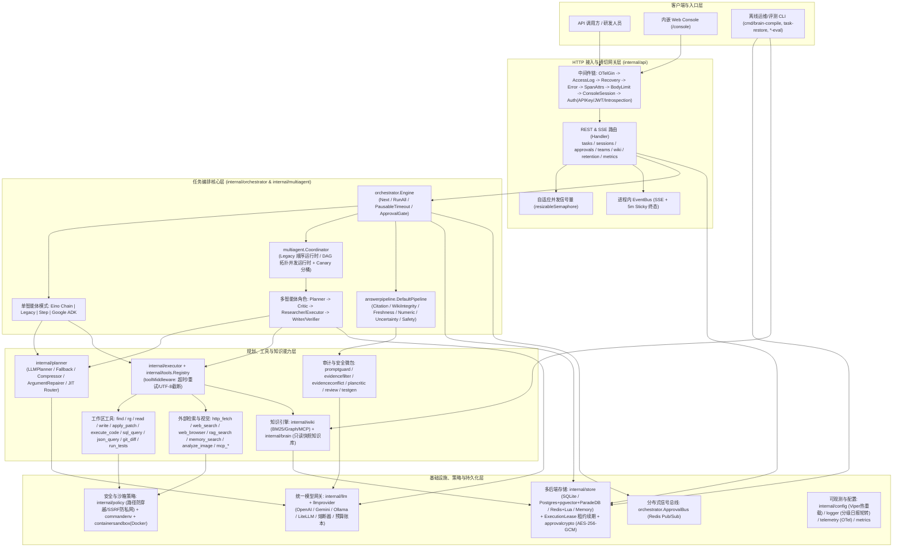
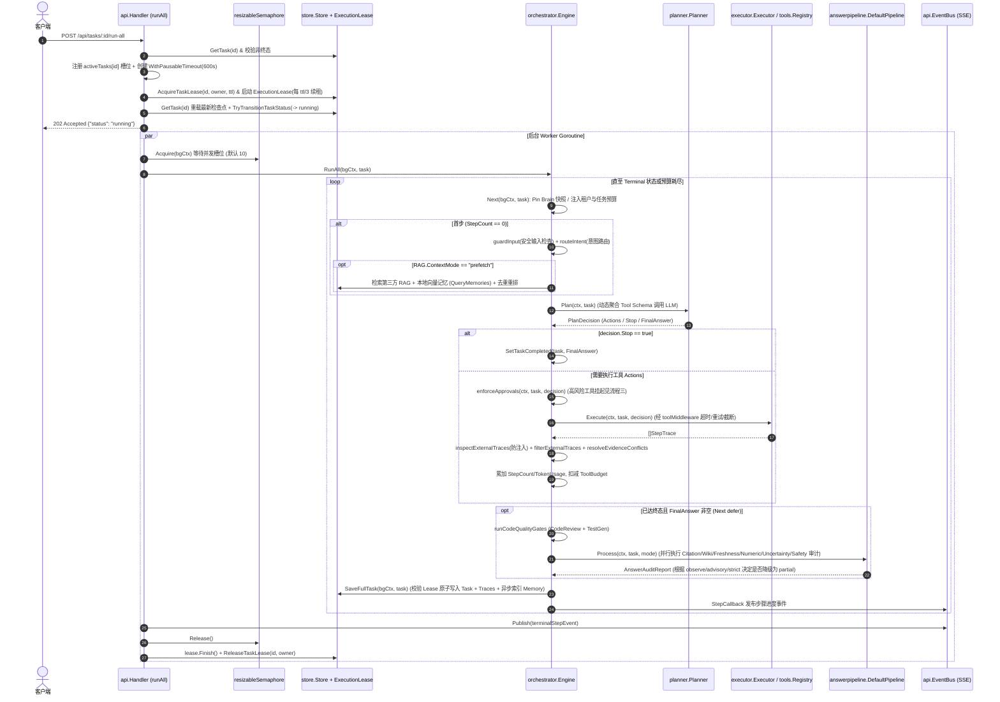
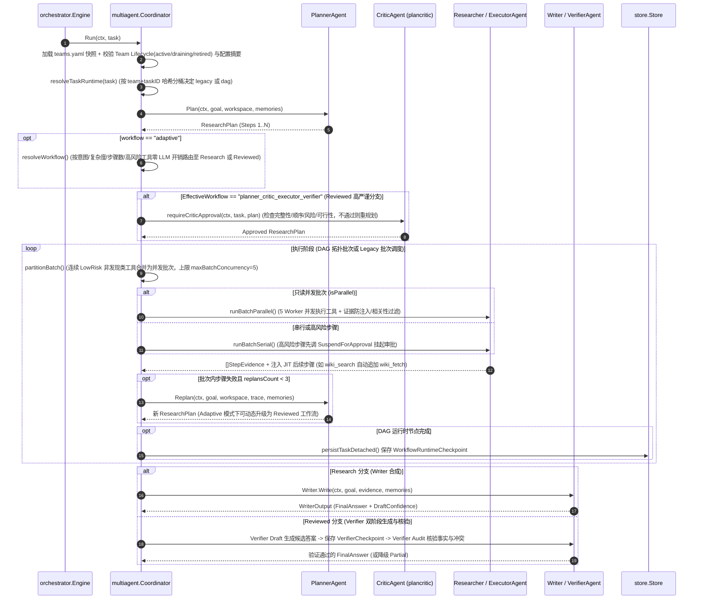
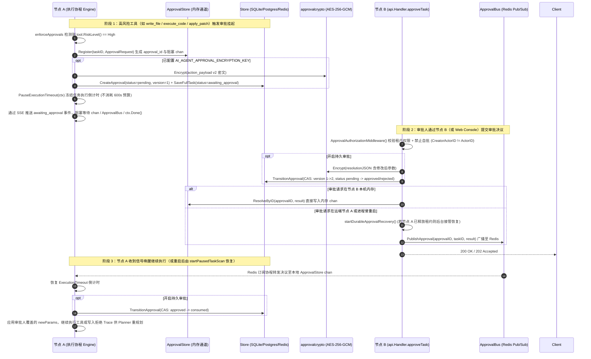
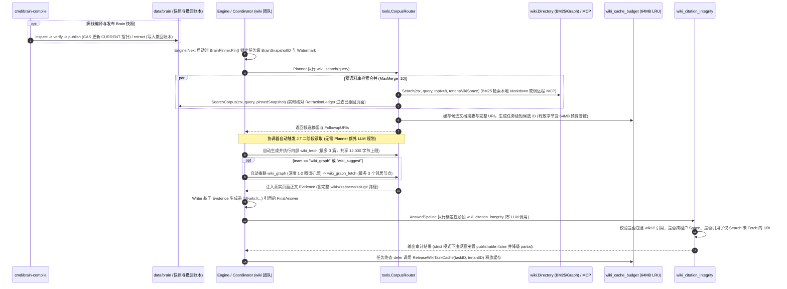

# AI-Agent 架构反推、开发方向与演进建议报告（2026-10-15）

### 1. 一句话定位 + 当前阶段判断

* **一句话定位**：【事实】这是一个基于 Go 1.26.8 构建的企业级多模型 AI Agent 运行时引擎（`go.mod:1-3`、`README.md:30-32`），面向需要**安全沙箱隔离、高风险工具人工审批（Human-in-the-Loop）、多智能体协同（Legacy/DAG 双运行时）、Wiki/Brain 知识检索与多维答案质量审计**的研发与知识问答场景。
* **当前阶段判断**：【推断】项目处于 **“v1.0.x 核心架构成型后的生产加固与发布收尾期（从快速迭代向生产准入过渡）”**。
  * 【事实】最近 50 次提交（`ee3e9af` 至 `dc4cd8b`）中，包含 14 次 `feat`（集中在持久审批密钥/签名核验、SQLite 内容版本账本与 Owned 执行门禁、Web Console 操作台）、11 次 `fix`（SQLite 只读边界、Windows 构建、外部 RAG 边界、Release 打包）、14 次 `docs`（验收记录与进度交接）、7 次 `P1/P2/P3` 架构加固与 HA 压测、3 次 `test`、1 次 `deps`（升级 grpc/x/text 安全补丁）。
  * 【事实】代码库无字面量开发 `TODO/FIXME/HACK` 积压（`rg` 仅命中 `internal/multiagent/writer_agent.go:26` 提示词规则及 `internal/multiagent/multiagent_test.go:56-58` 测试用例），但核心新特性（DAG 运行时、Brain 知识库、答案强制拦截、Docker 容器沙箱、Owned 执行门禁）在主配置 `config.yaml` 中均处于**保守默认关闭或观察态**（`config.yaml:116,184,189,199,607`），正在进行发布前收尾与环境验收（`docs/会话续接与完成进度_2026-10-13.md:1-15`）。

---

### 2. 项目画像（含第 0 步线索汇总）

#### 2.1 项目定位与核心价值
* 【事实】项目模块名为 `github.com/wuxujun/ai-agent`（`go.mod:1`），提供 HTTP REST + SSE 流式 API 与内嵌 `/console` Web 操作台（`internal/api/handler.go:65-146`）。它为上层业务系统或研发团队提供可控的 Agent 任务编排服务：通过五种执行模式（`eino`、`legacy`、`adk`、`step`、`multiagent`，见 `internal/orchestrator/engine_lifecycle.go:27-33`）调度文件/代码检索、补丁修改、命令执行、SQLite/JSON 查询、MCP 远程工具及 Wiki/RAG 检索，并通过租户工作区隔离、高风险动作挂起审批与 5 阶段答案质量流水线保障输出安全与可信度（`cmd/server/engine_builder.go:108-145`）。

#### 2.2 技术栈全景
| 维度 | 具体选型与证据 |
| :--- | :--- |
| **语言版本** | 【事实】`go 1.26.8`（`go.mod:3`、`.github/workflows/ci.yml:19`） |
| **Web 框架与认证** | 【事实】`github.com/gin-gonic/gin v1.12.0`（`go.mod:8`），支持 `api_key`、`jwt`（`golang-jwt/jwt/v5 v5.3.1` + JWKS）、`introspection`（远端 HTTPS 校验，默认开启于 `config.yaml:24,49`）及 `hybrid` 模式（`internal/api/middleware.go:180-220`），以及 AES-GCM 加密的 Console Cookie 会话（`internal/api/console_session.go:1-120`） |
| **AI / Agent 框架与 SDK** | 【事实】字节跳动 `github.com/cloudwego/eino v0.9.2`（`internal/orchestrator/eino.go:1-50`）、Google `google.golang.org/adk v1.3.0`（`internal/orchestrator/adk.go:1-50`）、`google.golang.org/genai v1.58.0`（`internal/llm/transport.go:19`），并自研原生 OpenAI Chat/Responses、Ollama、LiteLLM 网关结构化 JSON/流式调用层（`internal/llm/transport.go:25-150`） |
| **数据库与向量检索** | 【事实】4 种 `store.Store` 后端（`internal/store/open.go:1-40`）：① `modernc.org/sqlite v1.50.1`（纯 Go 无 CGO，默认 `data/agent.db`，`config.yaml:131-137`）；② PostgreSQL `github.com/lib/pq v1.12.3`（支持 `pgvector` HNSW 与 `ParadeDB` BM25+向量 RRF 混合检索，`internal/store/postgres.go:64-78`）；③ Redis `github.com/redis/go-redis/v9 v9.20.0`（Lua 脚本维护二级索引与状态机，`internal/store/redis.go:40-130`）；④ 内存 `MemoryStore`（`internal/store/memory.go:1-60`） |
| **缓存与消息总线** | 【事实】进程内：`EventBus`（SSE 订阅与 5 分钟粘性终态缓存，`internal/api/sse.go:39-65`）、Wiki 字节预算候选缓存（默认 64 MiB，`config.yaml:539`、`internal/tools/wiki_cache_budget.go:1-80`）；跨实例：基于 Redis Pub/Sub 的 `ApprovalBus`（分布式审批唤醒与取消广播，`cmd/server/build.go:68-102`、`internal/orchestrator/approval_bus.go:1-80`） |
| **外部服务与协议集成** | 【事实】MCP Streamable HTTP 客户端（`internal/mcpclient`）、本地/远程 LLM Wiki（`internal/wiki`）、Langfuse Prompt 管理（`internal/promptmanager`，`config.yaml:630-656`）、Firecrawl Web 搜索（`config.yaml:621`）、OpenTelemetry OTLP/stdout 追踪与指标（`go.opentelemetry.io/otel v1.44.0`，`internal/telemetry`） |

#### 2.3 运行形态与部署方式
* 【事实】**运行形态**：以**单体常驻 HTTP 服务进程**（`./cmd/server`）为核心，辅以 10 个独立离线 CLI 工具（`cmd/brain-compile`、`cmd/task-restore`、`cmd/canary-gate`、`cmd/ha-soak` 及 6 个 `*-eval` 评测工具）。工具执行支持宿主机子进程（默认）或 Docker 容器沙箱（`internal/policy/containersandbox`）。
* 【事实】**部署方式**：
  1. 跨平台静态编译单二进制（`CGO_ENABLED=0` 支持 darwin/linux/windows 5 平台打包，见 `build.sh:11-56`、`.github/workflows/release.yml:22-90` 及 `dist/` 目录下的 `1.0.1` 产物）；
  2. Linux `systemd` 守护进程（`deploy/systemd/ai-agent.service`）；
  3. 双节点 HA 容器化部署（`deploy/ha/compose.yaml`：PostgreSQL + Redis + 2 个 `ai-agent` 节点）及配套的 LiteLLM 网关（`deploy/litellm/compose.yaml`）与 OTel 可观测栈（`deploy/opentelemetry/docker-compose.yml`）。

#### 2.4 规模与第 0 步统计数据
* 【事实】**代码规模**：全仓共 **60 个 Go 包**（`cmd/` 下 11 个，`internal/` 下 48 个，`evals/runtime-fixtures` 1 个）；共 **653 个 `.go` 文件**，其中非测试生产代码 **314 个文件 / 74,191 行**，测试代码 **339 个文件 / 58,352 行**（测试与生产代码行数比高达 `0.79 : 1`）。
* 【事实】**依赖规模**：`go.mod` 直接依赖（direct）16 个核心库（含 OTel 子包共 23 项，`go.mod:5-29`），间接依赖（indirect）68 项（`go.mod:31-101`）。（注：当前分析沙箱禁止访问仓库外 `/Users/xujunwu/GoProject/pkg/mod/golang.org/toolchain@v0.0.1-go1.26.8.darwin-amd64/bin/go`，报 `Operation not permitted`，故跳过实时执行 `go list -deps` 与 `go test -cover`；但通过 `/private/tmp/ai-agent-c03-matrix-complete-full-20261014.log` 核实最近一次全仓 60 包测试均为 `ok`/PASS）。
* 【事实】**Git 活跃度**：单一主力作者（`wuxj9531` 332 次提交，`wuxujun` 2 次提交），无 Git tag（`build.sh:4` 默认 `1.0.0`，`dist/` 产物为 `1.0.1`），本地存在 `main`、`feat/brain-eval-p0`、`feat/brain-readonly-mvp` 及 4 个 `subagent-*-log-migrator-*` 分支。近 3 个月改动最频繁的文件依次为 `config.yaml`（43 次）、`internal/config/config.go`（40 次）、`internal/api/handler.go`（39 次）、`README.md`（33 次）、`internal/multiagent/coordinator.go`（26 次）、`internal/orchestrator/engine.go`（24 次）。
* 【事实】**废弃标记与 Feature Flags**：
  * `Deprecated`：仅 `internal/workspace/doc.go:9` 与 `internal/workspace/sandbox.go:9,15,25`（已完全被 `internal/tools.Registry` + `internal/orchestrator.Engine` 替代，全仓无任何非测试包引用）。
  * 大段注释配置：`config.yaml:283-336` 注释了 22 个可选 LLM 场景（如 `plan_critic`、`code_reviewer`、`fact_freshness_checker` 等，未启用时自动跳过对应 LLM 增强）；`config.yaml:599-609` 注释了 Docker 沙箱配置。
  * Feature Flags：`brain.enabled`（默认 `false`，`config.yaml:116`）、`multiagent.runtime`（`legacy` vs `dag` + `dag_canary_percent: 0`，`config.yaml:184-185`）、`answer_pipeline.enforcement`（`observe` / `advisory` / `strict`，默认 `observe`，`config.yaml:189`）、`langfuse.enabled`（默认 `false`，`config.yaml:633`）、`tool.sandbox.mode`（`local` vs `docker`，`config.yaml:600`）。

---

### 3. 架构分析

#### 3.1 整体架构图（Mermaid Flowchart）

#### 3.2 分层与包职责说明表

【事实】以下按架构层次列出全部顶级包（含 `cmd/` 与 `internal/`）的职责、对外暴露点、依赖与被依赖关系（由源码 import 静态分析得出）：

| 层级 | 包路径 | 生产代码 (文件/行数) | 核心职责与对外暴露点 | 依赖的内部包 | 被谁依赖 (内部逆向依赖) | 备注 |
| :--- | :--- | :--- | :--- | :--- | :--- | :--- |
| **入口层** | `cmd/server` | 7 / 1,367 | 生产 HTTP 服务主入口，组装 Store、MCP、Wiki/Brain、Engine、ApprovalBus、后台扫描协程与优雅退出（`main.go:83`、`runtime.go:42`） | 33 个 `internal/*` 包 | 无（二进制入口） | 唯一的线上常驻服务入口 |
| **入口层** | `cmd/brain-compile` | 1 / 233 | Brain 知识库快照离线编译、校验、CAS 发布与回滚 CLI | `brain`, `config`, `store` | 无 | 生产写 Brain 的唯一入口 |
| **入口层** | `cmd/task-restore` | 2 / 198 | Task 离线隔离恢复核验与准入评估 CLI | `approvalcrypto`, `store` | 无 | 默认恢复准入为 `blocked` |
| **入口层** | `cmd/*-eval`, `canary-gate`, `ha-soak`, `rag-eval-stub` | 8 / 2,216 | 离线质量门禁与压测 CLI（`brain-eval`, `wiki-eval`, `multiagent-eval`, `llm-eval`, `critic-eval`, `canary-gate`, `ha-soak`, `rag-eval-stub`） | 对应 `internal/*eval`, `canarygate`, `hasoak` 等 | 无 | 研发评测、CI 与灰度放量辅助工具 |
| **接入层** | `internal/api` | 33 / 6,086 | Gin 路由注册（`RegisterRoutes`）、中间件链、并发信号量、SSE `EventBus`、内嵌 `/console` 操作台及任务/审批/会话/归档 Handler | `brain`, `config`, `llm`, `logger`, `metrics`, `multiagent`, `orchestrator`, `policy`, `promptmanager`, `sanitize`, `store`, `telemetry`, `tools`, `types`, `wiki` | `cmd/server` | 承担了部分本应属于编排层的运行槽位与租约生命周期管理 |
| **编排层** | `internal/orchestrator` | 24 / 5,038 | 单步/全量任务执行引擎（`Engine.Next`/`RunAll`）、Eino/Legacy/ADK/Step 模式、可暂停超时（`WithPausableTimeout`）、持久审批与 Redis `ApprovalBus` | `answerpipeline`, `brain`, `config`, `executor`, `llm`, `memory`, `multiagent`, `planner`, `policy`, `store`, `tools`, `types` 及 10 个质量审计包（共 26 个） | `cmd/server`, `internal/api` | 扇出最高（依赖 26 个内部包）的核心枢纽 |
| **编排层** | `internal/multiagent` | 33 / 7,382 | 多智能体协调器（`Coordinator`）、Legacy 与 DAG 拓扑调度器、6 种 Agent 角色、Adaptive 路由、Canary 分桶、`teams.yaml` 生命周期管理与防篡改审计链 | `config`, `evidenceconflict`, `evidencefilter`, `llm`, `logger`, `metrics`, `plancritic`, `planner`, `policy`, `promptguard`, `promptmanager`, `sanitize`, `sourcecredibility`, `tools`, `types`, `wiki`（共 16 个） | `cmd/server`, `cmd/critic-eval`, `cmd/llm-eval`, `internal/api`, `internal/memory`, `internal/orchestrator` | 生产代码量第 2 大包 |
| **质量与审计层** | `internal/answerpipeline` | 4 / 974 | 答案发布前多阶段并行审计流水线（`DefaultPipeline.Process`），支持 `observe`/`advisory`/`strict` 三级门禁 | `config`, `factfreshness`, `llm`, `numericconsistency`, `planner`, `policy`, `sanitize`, `types`, `uncertainty` | `cmd/server`, `internal/orchestrator` | v2 版本支持基于证据摘要的幂等跳过与并发执行 |
| **质量与审计层** | `internal/plancritic`, `promptguard`, `evidencefilter`, `evidenceconflict`, `sourcecredibility`, `factfreshness`, `numericconsistency`, `uncertainty`, `review`, `testgen`, `diagnostics` | 12 / 2,589 | 11 个细粒度 LLM 审计/生成微包：计划评审、提示词注入检测、证据过滤、冲突消解、信源可信度、事实保鲜度、数值一致性、不确定性校准、代码审查、单测生成、失败诊断 | `llm`, `sanitize`, `types`, `config`, `policy`（部分审计包存在同级互相导入，详见 3.3） | `cmd/server`, `internal/orchestrator`, `internal/multiagent`, `internal/answerpipeline` | 单一职责清晰，但同级包存在阶梯式耦合 |
| **规划与执行层** | `internal/planner` | 19 / 3,248 | 规划器接口与实现（`LLMPlanner`, `FallbackPlanner`, `MockPlanner`）、动态 JSON Schema 合成、上下文压缩、工具参数修复、意图路由、JIT 检索策略 | `config`, `llm`, `llmprovider`, `logger`, `metrics`, `sanitize`, `skills`, `telemetry`, `tools`, `types` | `cmd/server`, `answerpipeline`, `braineval`, `executor`, `memory`, `multiagent`, `orchestrator` | Schema 从 `tools.Registry` 动态聚合 |
| **规划与执行层** | `internal/executor` | 1 / 138 | 单智能体批量工具调用分发器（`DefaultExecutor.Execute`） | `planner`, `tools`, `types` | `cmd/server`, `internal/orchestrator` | 轻量分发层 |
| **工具与知识层** | `internal/tools` | 29 / 5,466 | 工具注册表（`Registry`）、统一执行中间件（`toolMiddleware`：超时、重试、4000 字节 UTF-8 安全截断）及 18+ 内置工具实现 | `config`, `logger`, `mcpclient`, `policy`, `policy/commandenv`, `policy/containersandbox`, `skills`, `types`, `vision`, `wiki` | `cmd/server`, `api`, `criticeval`, `executor`, `multiagent`, `orchestrator`, `plancritic`, `planner` | 所有工具均通过 `Register` 自动包裹中间件 |
| **工具与知识层** | `internal/wiki` | 6 / 2,323 | 本地目录（BM25 + 引用图谱）与远程 MCP 双模只读 Wiki 检索引擎 | `mcpclient`, `policy` | `cmd/server`, `cmd/wiki-eval`, `api`, `brain`, `braineval`, `multiagent`, `tools`, `wikieval` | 局部刷新 + 严格路径防穿越 |
| **工具与知识层** | `internal/brain` | 15 / 4,344 | LLM 编译型项目知识库（Claim/Evidence 结构、快照 CAS 发布、防符号链接安全读取、逻辑撤回账本） | `config`, `evidencefilter`, `llm`, `sanitize`, `store`, `types`, `wiki` | `cmd/brain-compile`, `cmd/server`, `api`, `orchestrator` | 运行时只读，编译走 CLI |
| **工具与知识层** | `internal/memory` | 6 / 1,668 | 长期任务记忆提取、Embedding 生成、第三方 RAG 检索（MCP/REST）、记忆重排与冲突消解 | `config`, `llm`, `llmprovider`, `logger`, `multiagent`, `planner`, `telemetry`, `types` | `cmd/server`, `orchestrator`, `store` | 反向依赖了 `multiagent` 与 `planner`（见 3.3） |
| **工具与知识层** | `internal/skills`, `vision`, `mcpclient`, `promptmanager` | 7 / 1,613 | `skills`（解析 `SKILL.md`）、`vision`（多模态识图）、`mcpclient`（MCP 协议客户端）、`promptmanager`（Langfuse 3 级回退与版本固定） | `config`, `llm`, `logger`, `policy`, `types` | `cmd/server`, `api`, `multiagent`, `planner`, `tools`, `wiki` | 扩展能力适配层 |
| **安全与策略层** | `internal/policy` (+ `commandenv`, `containersandbox`, `restoreworkspace`) | 15 / 1,760 | 工作区边界与符号链接防逃逸（`ValidateWorkspace`）、SSRF 防私网 DNS 拨号（`ValidateURL`）、子进程环境变量白名单、Docker 容器沙箱、恢复目录校验 | `llm`, `types` | `cmd/server`, `api`, `orchestrator`, `multiagent`, `tools`, `store`, `wiki`, `mcpclient` 等 14 个包 | 安全基座，无反向业务依赖 |
| **基础设施层** | `internal/store` | 42 / 13,308 | 四种存储后端实现、任务租约（`ExecutionLease`）、持久审批存储、联合快照导出与离线恢复准入核验 | `approvalcrypto`, `config`, `logger`, `memory`, `policy/restoreworkspace`, `types` | `cmd/server`, `cmd/brain-compile`, `cmd/task-restore`, `api`, `brain`, `braineval`, `orchestrator` | **全仓最大包**（占生产代码 18%） |
| **基础设施层** | `internal/llm`, `internal/llmprovider` | 12 / 2,860 | 多模型结构化 JSON/流式/视觉/Embedding 传输层、场景路由、熔断器、每分钟重试预算、任务/租户成本账本 | `buildinfo`, `config`, `telemetry`, `types` | 全仓 24 个包依赖 `internal/llm` | 模型基础设施核心 |
| **基础设施层** | `internal/config`, `logger`, `telemetry`, `metrics`, `approvalcrypto`, `sanitize`, `buildinfo` | 12 / 4,359 | Viper 热重载配置、分级 JSON 日志与脱敏、OTel 初始化、本地指标聚合、AES-256-GCM 审批加解密 | 仅依赖 `buildinfo`, `llmprovider`, `policy/*` | 全仓广泛依赖 | 横切基础设施 |
| **领域模型层** | `internal/types` | 7 / 493 | 纯数据结构与契约定义（`Task`, `StepTrace`, `Memory`, `Session`, `ApprovalRequest`, `AnswerAuditReport`, `ExecutionAdmission`） | **0 个内部依赖** | 全仓 **32 个包**依赖 | 极度干净的底层共享模型包 |
| **评测与未接入包** | `internal/braineval`, `wikieval`, `multiagenteval`, `criticeval`, `canarygate`, `hasoak`, `authorityledger`, `workspace` | 19 / 6,910 | 6 个离线评测/压测包；`authorityledger`（C01 版本账本原型）；`workspace`（已废弃旧沙箱） | 对应被测包或 0 依赖 | 仅被 `cmd/*-eval` 依赖；**`authorityledger` 与 `workspace` 被依赖数为 0** | `authorityledger` 待接入，`workspace` 已废弃 |

#### 3.3 依赖方向与包结构健康度分析
* 【事实】**无循环依赖**：对全仓 60 个包进行静态导入图分析，不存在任何直接或间接循环依赖（DAG 依赖图成立）。
* 【事实】**无杂乱 `util/common` 垃圾桶包**：`internal/types`（493 行）和 `internal/sanitize`（26 行）均保持零内部依赖，职责高度内聚。
* 【事实】**存在 3 处逆向/同级耦合异味**：
  1. **存储层与记忆检索层反向耦合上层编排**：`internal/store` 导入了 `internal/memory`（`internal/store/sqlite.go:15`、`postgres.go:18`），而 `internal/memory` 反向导入了 `internal/multiagent` 和 `internal/planner`（`internal/memory/memory.go:14-15`），导致 `internal/store` 间接依赖了 `multiagent`、`planner` 和 `tools`。
  2. **同级质量审计包之间的阶梯式互相导入**：在构建证据目录（`evidenceCatalog`）时，同级审计包没有抽离公共的证据提取函数，而是层层导入同级包以引用 `TraceAction` 常量或辅助函数：
     * `internal/sourcecredibility` 导入 `internal/evidenceconflict`；
     * `internal/factfreshness` 导入 `evidenceconflict`, `promptguard`, `sourcecredibility`（`internal/factfreshness/checker.go:10-14`）；
     * `internal/numericconsistency` 导入 `evidenceconflict`, `promptguard`, `sourcecredibility`, `factfreshness`（`internal/numericconsistency/checker.go:11-16`）；
     * `internal/uncertainty` 导入上述全部 5 个同级包（`internal/uncertainty/calibrator.go:9-15`）。
  3. **全局单例残留**：虽然审批存储已重构为 `Engine.Approvals` 字段，但仍保留了包级 `defaultApprovals` 兜底（`internal/orchestrator/engine.go:72`、`engine_approvals.go:53-58`）；同时 `tools.DefaultRegistry`（`internal/tools/registry.go:96`）、`api.GetBus()`（`internal/api/sse.go:59`）、`planner.SkillRegistry`（`cmd/server/main.go:173`）和 `config.Get()` 仍为进程级全局状态。

#### 3.4 核心业务流程时序图（Mermaid SequenceDiagrams）

##### 流程一：异步全量执行与单智能体工具调用 + 答案质量流水线（`POST /api/tasks/:id/run-all`）
【事实】对应代码：`internal/api/task_execution.go:179-490`、`internal/orchestrator/engine_lifecycle.go:54-470`、`internal/answerpipeline/pipeline_v2.go:1-180`。

##### 流程二：Multi-Agent 双工作流（Adaptive 路由 + Legacy/DAG 运行时 + Replan 闭环）
【事实】对应代码：`internal/multiagent/coordinator.go:93-360`、`internal/multiagent/dag_scheduler.go:14-180`、`internal/multiagent/workflow_graph.go:42-90`。

##### 流程三：高风险工具跨实例持久审批与恢复流程（Durable Approval + Redis Pub/Sub）
【事实】对应代码：`internal/orchestrator/engine_approvals.go:20-380`、`internal/api/task_approval_handler.go:33-250`、`cmd/server/build.go:104-215`。

##### 流程四：只读知识库（LLM Wiki & Brain）双模检索与引用完整性校验
【事实】对应代码：`cmd/server/wiki_builder.go:62-250`、`internal/tools/wiki.go:1-220`、`internal/answerpipeline/wiki_citation_integrity.go:1-120`。

#### 3.5 数据与状态管理
* 【事实】**核心数据模型**（`internal/types/`）：
  * `Task`（`internal/types/task.go:108-159`）：聚合根，包含身份（`ID`, `TenantID`, `CreatorActorID`, `SessionID`, `SequenceNo`）、编排绑定（`Mode`, `Team`, `TeamConfigDigest`, `BrainProjectID`, `BrainSnapshotID`）、四维预算（`MaxSteps`, `ToolBudget`, `TokenBudget`, `LLMCallBudget`, `LLMCostBudgetUSD`）、状态机（`created` / `running` / `awaiting_approval` / `paused` / `completed` / `partial` / `failed` 及 `TerminationKind`）、维护版本（`MaintenanceVersion`, `TerminalSince`）、执行轨迹 `[]StepTrace`、检索记忆 `[]Memory` 与审计报告 `*AnswerAuditReport`。
  * `DurableApproval`（`internal/types/approval.go:1-90`）：独立于 Task 存储的持久审批记录，含 `Version`（乐观锁 CAS）、`Status`（`pending`/`approved`/`rejected`/`expired`/`consumed`）及 AES-256-GCM 加密的 `ActionPayload` 与 `ResolutionPayload`。
* 【事实】**存储选型与事务边界**：
  * **SQLite**（`internal/store/sqlite.go:34-165`）：强制 `SetMaxOpenConns(1)` + `PRAGMA journal_mode=WAL` + `PRAGMA busy_timeout=5000`，规避 `SQLITE_BUSY`。`SaveFullTask` 在单个数据库事务中校验 `task_leases` 持有者、递增 `maintenance_version`、更新 `tasks` 主表并全量替换/追加 `traces` 表。
  * **PostgreSQL**（`internal/store/postgres.go:53-180`）：支持连接池配置，使用 `JSONB` 存储 `answer_audit_json`，支持 `pgvector` HNSW 索引与 `ParadeDB` 混合检索；同样在事务中原子校验 `task_leases` 并写入 `tasks` 与 `traces`。
  * **Redis**（`internal/store/redis.go:40-150`）：通过内嵌 Lua 脚本（`saveTaskScript`）在单次原子调用中校验租约 Key、防篡改比对 `creator_actor_id`、递增 `maintenance_version`、局部 Patch JSON 顶层字段并同步更新多个 ZSET 二级索引（按租户、状态、摘要分页）。
* 【事实】**缓存策略与一致性假设**：
  * 进程内 `EventBus` 仅做实时推送与 5 分钟终态提示（`stickyTerminalTTL = 5 * time.Minute`，`internal/api/sse.go:39`），明确声明**不做持久化事件日志或重放游标**；SSE 客户端重连或周期对账时直接读取权威 Store 快照（`internal/api/sse.go:220-310`）。
  * 多实例并发写同一个 Task 靠数据库行级租约 `task_leases`（`AcquireTaskLease` / `RenewTaskLease`）+ 带租约校验的 `SaveFullTask` 实现互斥（`internal/store/store.go:22-35`）；当租约续期失败或超时，`ExecutionLease` 立即触发 `onLoss` 取消本地执行 Context（`internal/store/execution_lease.go:29-95`）。

#### 3.6 并发模型与生命周期
* 【事实】**请求级与任务级并发控制**：
  * `Handler.taskSem`（`internal/api/semaphore.go:21-98`）：手写支持热重载动态扩缩容（`Resize`）的 FIFO 等待队列信号量，默认限制进程内最多 10 个并发执行任务（`config.yaml:170`）。解决取消竞争时，若 `Acquire` 授权与 `ctx.Done()` 同时到达，会自动归还槽位并唤醒下一个等待者（`semaphore.go:50-56`）。
  * `Handler.activeTasks`（`internal/api/handler.go:47-53`）：以指针标识（`*activeRun`）登记本机活跃任务，防止旧协程 `defer` 误删新协程注册的同名任务槽位。
* 【事实】**多智能体批次并发**：
  * 在 `multiagent` 模式下，`Coordinator.runBatchParallel`（`internal/multiagent/dag_scheduler.go:271-350`）使用固定上限 `maxBatchConcurrency = 5` 的 Worker Pool（通过 `jobs` channel 分发索引）并发执行连续的 `RiskLevelLow` 只读工具；每个 Worker 写入独立的 `results[idx]` 槽位，全部完成后再单线程合并追加到 `task.Trace`，做到零锁竞争。
* 【事实】**答案审计并发**：
  * `answerpipeline` 在 `parallel_audits: true`（`config.yaml:192`）时并发启动各审计 Stage 协程，汇总结果后统一判定门禁（`internal/answerpipeline/pipeline_v2.go:120-230`）。
* 【事实】**后台常驻/定时任务与优雅退出**：
  * 启动时拉起 3 类受控后台协程（`cmd/server/build.go:49-53`、`runtime.go:42-126`）：
    1. `startPausedTaskScan`：启动后限时 30s 扫描上次停机遗留的 `paused` 任务与已决议但未恢复的 `awaiting_approval` 任务并自动恢复；
    2. `startApprovalExpiryScan`：每 1 分钟扫描过期 `pending` 审批（默认 TTL 24 小时），每 1 小时清理超过保留期（默认 30 天）的终态审批记录（`cmd/server/build.go:229-250`）；
    3. `buildApprovalBus`：订阅 Redis 跨实例审批与取消信号。
  * **优雅退出（Graceful Shutdown）顺序严格**（`cmd/server/runtime.go:88-125`）：收到 `SIGINT/SIGTERM` 后，先 `server.Shutdown` 停止接收新 HTTP 请求 -> 停止并等待 `paused` 启动扫描结束 -> 调用 `tasks.Shutdown` 等待所有后台 `run-all` 任务排空（超时未完的任务在 `Handler.Shutdown` 中自动回滚状态为 `StatusPaused` / `TerminationShutdownRollback`，支持下次重启恢复）-> 最后关闭 `ApprovalBus` 与 `approvalExpiryRuntime`（确保排空期间仍能收到远端审批/取消信号）。

#### 3.7 接口与扩展点
* 【事实】**对外接口**：REST API（35+ 路由，涵盖任务、会话、审批、审计、记忆、团队生命周期、归档核验、指标、健康就绪探针，见 `internal/api/handler.go:65-146`）、SSE 实时流（`GET /api/tasks/:id/stream` 及 `run?stream=true`）、内嵌 Web Console（`/console`）。无 gRPC 服务端（`google.golang.org/grpc` 仅为 Google Cloud/GenAI SDK 的间接依赖）。
* 【事实】**五大核心扩展点**：
  1. **工具扩展（`tools.Tool` 接口）**：实现 `Name/Description/Parameters/RiskLevel/Execute` 并注册到 `tools.Registry`（`internal/tools/registry.go:22-65`），Planner 的 JSON Schema（OpenAI 与 Gemini 双格式）与参数校验会自动合并新工具，无需手改 Planner 代码。
  2. **MCP 动态工具发现**：通过 `config.yaml` 的 `mcp.servers[]` 配置任意 Streamable HTTP MCP 服务，启动时自动调用 `tools/list` 发现并挂载为 `<prefix>_<tool>`（`cmd/server/mcp_builder.go:35-65`）。
  3. **多智能体团队声明式扩展（`teams.yaml`）**：无需改 Go 代码即可新增 Team、绑定工作流（`planner_researcher_writer` / `planner_critic_executor_verifier` / `adaptive`）、配置工具白名单、Langfuse Prompt 标签与生命周期状态（`active`/`draining`/`retired`）。
  4. **多模型提供方与按场景路由（`llm.scenes`）**：`internal/llmprovider` 统一抽象协议能力，支持在 `config.yaml:240-336` 为 29 个细分调用点（如 `task_planner`、`multiagent_writer`、`plan_critic` 等）独立指定模型、网关、超时、Fallback 场景及按剩余 Token/步骤数/意图的动态路由规则。
  5. **技能扩展（`skills/<name>/SKILL.md`）**：基于 Markdown Frontmatter 的渐进式技能发现与按需加载（`use_skill` 工具，`internal/skills`）。

#### 3.8 横切关注点
* 【事实】**日志与隐私安全**：`internal/logger` 基于标准库 `log/slog` 封装，按级别每日轮转文件（`info-YYYY-MM-DD.log` 等），独立输出 `access-YYYY-MM-DD.log` 与任务报告日志（`internal/logger/logger.go:1-120`）。`AccessLogMiddleware` 与 `RecoveryMiddleware` 严格禁止记录 `Authorization`、`X-API-Key`、Cookie、Query、Request Body 及 Panic 原始结构体（`internal/api/middleware.go:80-165`）；所有工具与错误输出写入 Trace 前均经过 `sanitize.Secrets` 正则脱敏（`internal/sanitize/secrets.go:1-26`）。
* 【事实】**指标与可观测性**：双轨制并行——既支持 OpenTelemetry OTLP/stdout 导出 Trace 与 Metric（`internal/telemetry`），又内置零外部依赖的进程内 `metrics.Collector`（`GET /api/metrics`），统计 Planner/Executor/RAG/AnswerPipeline/MultiAgent 耗时、Token 消耗、成本估算、Wiki 缓存命中与团队生命周期事件（`internal/metrics/metrics.go:1-200`）。
* 【事实】**鉴权与多租户隔离**：默认 Fail-Closed（未配 Key 返回 503，`internal/api/middleware.go:199`）；支持租户级工作区根目录强制隔离（`ValidateWorkspaceWithinRoot`）、租户级 Team 白名单、租户级 Wiki/Brain Space 隔离、租户级每日 LLM 调用次数与美元成本配额（`TenantUsageLedger`），以及基于个人 `ActorID` 的审批白名单与**禁止自批**（`ApprovalDisallowSelf`，`internal/api/approval_policy.go:1-80`）。
* 【事实】**配置热重载**：通过 Viper + `fsnotify` 监听配置文件变化，同时支持 `SIGHUP` 与 `POST /api/config/reload`（`cmd/server/main.go:223-248`）；候选配置必须先通过完整的 `Config.Validate()` 及跨文件 `ValidateTeamRoutingConfig` 校验才原子替换全局快照，非法配置保留旧快照不中断服务。

#### 3.9 架构评估与最大的 3 个结构性问题
* **架构风格评估**：【推断】整体属于 **“面向领域的模块化分层架构（Modular Layered Architecture）+ 插件化注册表模式”**，没有过度套用 DDD/六边形的繁琐样板代码（如 DTO/PO 层层转换），与当前 7.4 万行生产代码的规模基本匹配，工程防御性（超时、限额、防逃逸、CAS 状态机、竞态测试）极强。
* **最大的 3 个结构性问题**：
  1. 【事实】**`internal/store` 包严重膨胀且职责越界（42 个文件 / 13,308 行，占全仓生产代码 18%）**：`internal/store` 不仅包含 4 种数据库后端的 CRUD、租约和审批存储，还塞入了大量离线恢复准入策略（`task_restore_admission*.go`）、Ed25519 来源签名核验（`task_restore_approval_source*.go`、`task_restore_dependency_authority.go`）、密钥管理核验（`task_restore_keys.go`）以及 SQLite 专用触发器版本账本与执行门禁（`sqlite_restore_*.go`、`sqlite_execution_*.go`，仅这批恢复与门禁代码就超过 4,500 行）。这导致基础设施存储层变成了半个“恢复与安全控制面”。
  2. 【事实】**任务执行生命周期与并发所有权逻辑横跨 `api`、`orchestrator`、`store` 三层，存在双轨并存复杂度**：`internal/api/task_execution.go`（580 行）在 HTTP Handler 层直接管理内存槽位 `activeTasks`、信号量 `taskSem`、数据库租约 `ExecutionLease`、可暂停超时 `WithPausableTimeout` 和状态机 CAS；同时近期又在 `internal/api/sqlite_owned_*.go` 和 `internal/orchestrator/sqlite_owned_execution.go` 新增了一套默认未启用的 `ownedSQLiteStepAdapter` / `sqliteExecutionGate` 执行链，导致单步/全量/审批恢复在代码里存在两套高度相似但边界不同的并发控制路径。
  3. 【事实】**`orchestrator.Engine` 上帝对象扇出过高（依赖 26 个内部包）且存在同级审计包阶梯式耦合**：`Engine` 结构体直接持有 16 个细分 LLM 组件字段（`cmd/server/engine_builder.go:118-134`、`internal/orchestrator/engine.go:39-60`），每增加一个质量检查器都要修改 `Engine` 结构体、`engine_builder.go` 和 `engine_gates.go`；同时 `factfreshness`、`numericconsistency`、`uncertainty` 等同级包为了拼接证据目录而层层互相 import（见 3.3）。

---

### 4. 开发方向判断

#### 4.1 近期提交分布与半成品信号
* 【事实】**近期提交主题分布**（近 50 次提交）：
  * **恢复准入与权威控制面（C01–C03 / S01–S03）**：占比约 35%（如 `dc4cd8b`, `8fd19bf`, `86bd534`, `17d134e`, `5aa898a`, `5052421`），围绕 Task 联合快照导出、离线恢复准入、SQLite 触发器版本账本、Owned 执行门禁与崩溃回归展开。
  * **Web Console 操作台与生产安全隔离（G01–G07）**：占比约 25%（如 `9dfd040`, `6910692`, `fbec156`, `cc7d199`, `21ebff6`），完成了内嵌 Web UI、个人身份禁止自批、Docker 容器沙箱、子进程环境变量净化。
  * **Wiki / Brain 只读知识库与检索加固**：占比约 20%（如 `7635c75`, `3b5b59c`, `f1f7fe0`, `982366c`）。
  * **HA 双实例压测与文档同步**：占比约 20%（如 `b0621c7`, `9aeb24b`, `913a7ec`, `e7e1319`）。
* 【事实】**代码中的半成品/未接入信号**：
  1. `internal/authorityledger`（1,020 行）：已完成 SQLite 耐久版本账本与独立 floor 数据库原型，但**全仓没有任何非测试包 import 它**（`docs/会话续接与完成进度_2026-10-13.md:187-191`）。
  2. `Handler.ownedSQLiteStep`、`Handler.ownedSQLiteRunAll` 与 `Engine.ownedApprovalDispatcher`：代码与单测/崩溃矩阵测试已写完（`internal/api/sqlite_owned_step.go`、`sqlite_owned_all.go`、`internal/orchestrator/sqlite_owned_execution.go`），但在 `cmd/server/build.go` 生产启动路径中**全部保持 `nil` 未注入**（`docs/待优化/Task恢复与权威控制面后期优化_2026-10-14.md:11-15`）。
  3. `internal/store/task_restore_admission.go`：定义了 9 类强制恢复准入证据检查器，但 `task_restore_admission_persistent.go` 目前仅接入了 `workspace` 和 `key_management` 2 类，其余 7 类（如 `external_audit`, `memory_index` 等）仍缺真实权威实现，因此恢复评估固定返回 `decision=blocked`、`restore_ready=false`（`docs/当前未完成事项清单_2026-10-13.md:27`）。
  4. **与 README 宣称能力的差距**：README 展示了完整的双工作流、DAG 运行时、Brain 知识库、Docker 容器沙箱和 5 阶段答案质量流水线，但主配置 `config.yaml` 中：
     * `multiagent.runtime` 仍为 `legacy`，`dag_canary_percent: 0`（`config.yaml:184-185`）；
     * `brain.enabled` 为 `false`（`config.yaml:116`）；
     * `answer_pipeline.enforcement` 为 `observe`（仅记录不拦截，且默认 `llm.scenes` 注释掉了 `fact_freshness_checker` 等 22 个扩展场景，`config.yaml:189,283-336`）；
     * `tool.sandbox` 默认未开启 Docker（`config.yaml:599-609`）。

#### 4.2 方向假设表（假设 | 证据 | 置信度）

| 编号 | 方向假设 | 核心证据（代码 / 配置 / 文档 / 提交） | 置信度 |
| :--- | :--- | :--- | :--- |
| **假设 1** | **近期首要目标是完成“企业内网/多租户知识问答与受控研发助手”的 v1.0.1 正式交付上线（以 Web Console + Introspection 统一身份 + Wiki/RAG 为核心交付物）** | 1. 【事实】`config.yaml:24,49,73-108` 已配置真实企业域名 `https://api.thinktown.com/api/auth/check` 与 `project_a` 租户（默认绑定 `wiki` 与 `wiki_graph` 团队）； 2. 【事实】最新活跃文档 `docs/会话续接与完成进度_2026-10-13.md:11-18` 与 `docs/Web-UI发布前检查与登录排障_2026-10-14.md:1-35` 明确将“Web UI 发布准备与真实 Token 登录确认”列为当前唯一主工作线； 3. 【事实】`dist/` 目录已生成 `ai-agent-1.0.1-*` 五平台发行包，且刚修复了 Release 工作流（`a59fcc9`）。 | **高** |
| **假设 2** | **项目正在构建一套高安全合规的“金融/政企级可审计、可防篡改、可离线灾备恢复”的权威执行控制面，但因复杂度过高已主动踩刹车暂缓** | 1. 【事实】近 10 次提交密集开发了 AES-GCM 审批密文 Ed25519 来源签名核验（`5aa898a`）、SQLite 12 个触发器的物理行+内容版本账本（`86bd534`, `8fd19bf`）、Owned 执行门禁与子进程六边界强制 kill 回归（`dc4cd8b`）； 2. 【事实】`docs/待优化/Task恢复与权威控制面后期优化_2026-10-14.md:1-45` 明确记录：按用户要求，将未完成的 C03c（可信重开/writer fencing）和 C04（独立 signer/trust 服务）移入“待优化”暂缓，不阻塞当前默认功能发布。 | **高** |
| **假设 3** | **中长期演进方向是从“单机 SQLite + Legacy 顺序多智能体”全面切换到“PostgreSQL/Redis 双活 HA + DAG 并发图引擎 + Brain 编译型知识库”** | 1. 【事实】代码已完整实现 `DAG` 拓扑调度与 Checkpoint 恢复（`internal/multiagent/workflow_graph.go`）、`cmd/canary-gate` 灰度门禁、`cmd/ha-soak` 压测工具与 `deploy/ha/compose.yaml` 双实例部署栈； 2. 【事实】`internal/brain`（4,344 行）与 `internal/braineval`（3,399 行）投入了约 10% 的全仓代码量，且刚通过 Gemini live gate 评测（`1943323`）； 3. 【事实】`docs/当前未完成事项清单_2026-10-13.md:40-48` 记录 HA 完整 1 小时 Soak 验收与 DAG 20%/50%/100% 放量目前处于“明确延后”状态。 | **高** |

---

### 5. 技术债与演进路线图

#### 5.1 当前最该做的 5 件事（按 投入/收益比 排序）

1. **【极高收益 / 极低投入】完成服务重启与 Web Console 真实身份登录、权限及 SSE 冒烟闭环**
   * **依据**：【事实】`docs/Web-UI发布前检查与登录排障_2026-10-14.md:54-75` 显示 `.env` 中的 `AI_AGENT_CONSOLE_SESSION_KEY` 晚于当前 8088 进程启动时间写入（`godotenv.Load` 仅在启动时执行，`cmd/server/main.go:85`）。只需重启服务并用真实 `thinktown.com` Bearer Token 跑通登录、禁止自批与任务流式执行，即可解锁整个 Web 操作台的交付价值。
2. **【高收益 / 低投入】冻结未启用的 C01–C03 恢复控制面实验分支，清理/归档已废弃的 `internal/workspace` 包**
   * **依据**：【事实】`internal/workspace`（151 行）已明确标记 `Deprecated` 且全仓零引用（`internal/workspace/doc.go:9`）；而 `internal/authorityledger` 与 `sqlite_owned_*` 虽已提交但默认不启用。明确冻结实验面、移除死包可立即降低认知负担。
3. **【高收益 / 低投入】打通远端 GitHub Actions CI / Release 与三浏览器 Playwright 回归矩阵**
   * **依据**：【事实】`.github/workflows/ci.yml:52-88` 与 `release.yml` 已在本地提交修复（`a59fcc9`, `9dfd040`），但本机 Node 版本（PATH 默认为 16.13.0，Playwright 需 `/opt/homebrew/bin/node` 22.22.0）与远端 Actions 尚未在最新 HEAD 上触发验证（`docs/Web-UI发布前检查与登录排障_2026-10-14.md:20-38`）。
4. **【中高收益 / 中等投入】在 `internal/types` 提取公共审计证据目录构建器，解除 6 个同级质量审计包的阶梯式耦合，并解除 `store -> memory -> multiagent/planner` 的反向依赖**
   * **依据**：【事实】`factfreshness`、`numericconsistency`、`uncertainty` 等包仅因共享 `TraceAction` 常量与 `evidenceCatalog` 逻辑而层层互相导入（`internal/uncertainty/calibrator.go:9-15`）；将这些常量与纯函数下沉到 `internal/types`（或轻量 `internal/auditcatalog`），可瞬间理顺同级包边界。
5. **【中高收益 / 中等投入】将 `internal/store` 中的离线恢复准入、来源签名核验与 SQLite 版本门禁拆出独立包（如 `internal/restore`）**
   * **依据**：【事实】`internal/store` 目前高达 42 个文件 / 13,308 行，其中 `task_restore_*.go` 与 `sqlite_restore_*.go` / `sqlite_execution_*.go` 占了 21 个文件 / 约 5,000 行。将恢复核验控制面从基础 CRUD Store 中剥离，能让 `internal/store` 回归纯粹的数据访问层。

#### 5.2 重构建议（先做什么、不要做什么、如何渐进式迁移）
* **先做什么**：
  1. 先把同级审计包的 `TraceAction` 常量下沉到 `internal/types/answer_audit.go`，砍断 `uncertainty -> numericconsistency -> factfreshness -> sourcecredibility -> evidenceconflict` 的同级依赖链。
  2. 将 `internal/memory/memory.go` 中使用到的 `multiagent` / `planner` 辅助判断改为通过接口或 `types` 传递，切断 `internal/store -> internal/memory -> internal/multiagent` 的倒挂依赖链。
* **不要做什么（防过度抽象）**：
  1. **不要引入 DDD 仓储/领域服务多层抽象或依赖注入框架（如 Wire/Fx）**：当前 `cmd/server/engine_builder.go` 与 `build.go` 的显式手写装配（约 400 行）非常清晰直观，引入 DI 框架反而会破坏可读性。
  2. **不要在现阶段继续扩写 `authorityledger` 或 `sqlite_owned_*` 的复杂跨进程协议**：在单机 SQLite 默认部署尚未切换到生产多实例前，继续叠加触发器账本和双重执行适配器属于超前设计。
* **如何渐进式迁移**：
  * **第 1 步（零行为变更）**：移动 `TraceAction` 常量与纯函数，运行 `go test ./internal/...` 验证。
  * **第 2 步（文件级物理拆分）**：将 `internal/store/task_restore_*.go` 迁往 `internal/restore`，保留 `store.Store` 核心接口不变。
  * **第 3 步（收口执行生命周期）**：待后续决定是否保留 `ownedSQLiteStepAdapter` 时，将 `internal/api/task_execution.go` 中的租约 + 信号量 + 超时包装逻辑下沉为 `orchestrator.TaskRunner` 统一入口，使 `internal/api` 只负责 HTTP 协议转换与 SSE 写出。

#### 5.3 技术债清单

| 债务项 | 证据位置 | 具体影响 | 修复成本 | 建议时机 |
| :--- | :--- | :--- | :--- | :--- |
| **1. `internal/store` 包职责过载（1.33 万行）** | `internal/store/`（42 个生产文件，含 21 个恢复/版本门禁文件） | 存储层与恢复准入控制面强耦合，编译与阅读认知成本高，新增 Store 实现负担重 | 中（2-3 天） | v1.0.1 发布稳定后（中期） |
| **2. 普通租约执行链与 `ownedSQLite*` 执行链双轨并存** | `internal/api/task_execution.go:56-59,199-202` vs `sqlite_owned_step.go`, `sqlite_owned_all.go` | 任务执行、取消、审批恢复存在两套分支，且 `owned` 分支在线上始终为 `nil`，增加维护心智负担 | 中（2-3 天） | 确认恢复控制面取舍后 |
| **3. `memory` 反向依赖 `multiagent`/`planner`，连带污染 `store` 依赖树** | `internal/memory/memory.go:14-15`、`internal/store/sqlite.go:15` | 底层 `store` 间接依赖了上层业务编排包，破坏了自顶向下的严格分层 | 低（0.5 天） | 短期（1-2 周内） |
| **4. 6 个同级质量审计包阶梯式互相导入** | `internal/uncertainty/calibrator.go:9-15`、`numericconsistency/checker.go:11-16` | 同级微包无法独立演进，修改一个审计器可能影响其他审计器 | 低（0.5 天） | 短期（1-2 周内） |
| **5. `orchestrator.Engine` 结构体字段过多（上帝对象）** | `internal/orchestrator/engine.go:33-95`（30+ 字段，导入 26 个内部包） | 每次新增 LLM 辅助能力都要穿透修改 `Engine` 与 `engine_builder.go` | 中（1-2 天） | 中期（后续新增审计阶段时） |
| **6. 已废弃包 `internal/workspace` 与未接入包 `internal/authorityledger` 残留** | `internal/workspace/doc.go:9`、`internal/authorityledger/` | 存在死代码与未接线原型，容易误导新加入的开发者 | 极低（1 小时） | 短期（需人工确认删除授权后） |
| **7. 全局单例残留（`defaultApprovals`, `DefaultRegistry`, `globalEventBus`, `config.Get()`）** | `internal/tools/registry.go:96`, `internal/api/sse.go:52`, `internal/orchestrator/engine_approvals.go:53` | 虽已在部分结构支持实例注入，但包级默认单例仍可能在并行集成测试中引发隐式状态共享 | 低-中（1-2 天） | 中长期（按需在测试隔离受阻时推进） |

#### 5.4 可选升级路线图
* **短期（1–2 周）：聚焦 v1.0.1 生产交付与低成本整洁化**
  1. 完成 `.env` 重启生效验证、真实 `thinktown.com` Introspection Token 登录、个人审批白名单（`actors` 模式）与禁止自批在线验收（U04）。
  2. 使用 Node 22 跑通本地与 GitHub Actions 远端的三浏览器（Chromium/Firefox/WebKit）Playwright 回归及五平台 Release 构建（U07）。
  3. 解除 `memory -> multiagent/planner` 反向依赖与同级审计包互相导入。
* **中期（1–2 月）：生产沙箱落地、核心模块解耦与业务质量基线**
  1. 在目标 Linux 生产主机完成 Docker 容器沙箱（`tool.sandbox.mode: docker`）落地，补齐工作区磁盘配额与进程崩溃后的容器残留对账（U05）。
  2. 将 `internal/store` 中的 `task_restore_*` 拆分为独立包；在专用可丢弃 PostgreSQL 实例上完成联合导出、轻量快照与隔离恢复的专项事务验收（U06）。
  3. 基于真实业务问答样本与固定模型预算，运行 `cmd/wiki-eval`、`cmd/brain-eval` 与答案审计流水线，校准误判率后将 `answer_pipeline.enforcement` 从 `observe` 逐步升级至 `advisory` / `strict`（U09）。
* **长期（2 个月以上）：HA 双活、DAG 全面放量与权威恢复控制面闭环**
  1. 补齐 `deploy/ha` 完整 1 小时 Soak 压测（含故障注入、租约失联 fencing、跨节点 SSE 与审批恢复断言），将 `multiagent.dag_canary_percent` 按 `5% -> 20% -> 50% -> 100%` 灰度切换至 `DAG` 运行时。
  2. 若业务确有跨环境合规恢复诉求，重启 C03c/C04 工作线：接入外部 KMS/Secret Manager 与独立签名信任服务，补齐 `task_restore_admission` 剩余 7 类检查器并启用 `owned` 执行门禁。

---

### 6. 需要我确认的问题清单（按重要性排序）

1. **【待确认】生产部署形态与存储选型**：近期正式上线的目标环境是 **单实例 + SQLite**（如当前 `config.yaml:131-137` 默认配置），还是计划直接采用 **PostgreSQL + Redis 双实例 HA**（`deploy/ha/compose.yaml`）？这直接决定了 PostgreSQL 专项验收（U06）和 HA Soak 压测（F03）是否是近期上线的硬阻塞项。
2. **【待确认】C01–C03 恢复与权威控制面（`authorityledger` / `sqlite_owned_*`）的产品定位**：这套高强度的触发器版本账本与 Owned 执行门禁，是为了满足特定的**外部合规/安全审计硬性要求**，还是工程探索性质的防御性设计？如果是后者，是否允许在后续重构中将其简化或从主干 `internal/store` / `internal/api` 中剥离？
3. **【待确认】外部身份服务（`thinktown.com`）的字段契约与 RBAC 范围**：`config.yaml:49-53` 配置了 `https://api.thinktown.com/api/auth/check`（`tenant_claim: "data.userid"`）。该接口在实际生产环境中是否已稳定返回代表个人身份的唯一字段（如 `data.sub`）以开启 `require_subject: true` 和 `approval_disallow_self: true`？近期是否需要除 `admin: true/false` 之外的细粒度 RBAC？
4. **【待确认】工具执行沙箱的目标安全级别**：线上环境是否允许 Agent 执行用户触发的 `execute_code` / `write_file` / `apply_patch`？如果允许，宿主机是否具备 Docker Engine 环境以强制开启 `tool.sandbox.mode: docker`，还是仅在受信任内网使用 `local` 子进程模式（主要运行只读 `wiki` / `kb_qa` 团队）？
5. **【待确认】答案质量流水线与 22 个注释 LLM 场景的预算策略**：`config.yaml:283-336` 默认注释了 `fact_freshness_checker`、`numeric_consistency_checker`、`plan_critic` 等场景以节省 Token 成本。线上生产环境的单任务延时 SLA 与 Token/美元成本预算大约是多少？打算启用哪几个核心审计场景并将 `answer_pipeline.enforcement` 设为 `advisory` 还是 `strict`？
6. **【待确认】废弃包 `internal/workspace` 的清理授权**：`internal/workspace` 已标记 `Deprecated` 且全仓无任何引用，后续整理代码时是否授权彻底移除该目录？

---

### 7. 本次分析的局限与假设

1. **只读与沙箱环境限制**：【事实】本次分析严格遵守只读约束，未修改任何业务代码或配置文件。由于当前运行沙箱限制访问仓库目录外的 `/Users/xujunwu/GoProject`（Go 1.26.8 工具链安装位置）和 `/Users/xujunwu/.gitconfig`，实时 `go list -deps` 与 `go test -cover` 命令因 `Operation not permitted` 无法直接调用二进制；包依赖图与代码行数是直接通过 Python 脚本静态解析全仓 653 个 `.go` 源文件得出（精确度 100%），测试通过状态依据 `/private/tmp/ai-agent-c03-matrix-complete-full-20261014.log` 等既有全仓测试日志交叉核实。
2. **外部依赖未做在线联调**：【事实】未连接外部 PostgreSQL、Redis、LiteLLM 网关、Langfuse、Docker 守护进程或 `thinktown.com` 认证接口，关于外部集成行为的结论均基于源码实现与 `*_test.go` 契约测试反推。
3. **以主干配置文件为基准**：【事实】所有默认开启/关闭状态的判断均以主配置 `config.yaml` 与 `teams.yaml` 为准，未读取 `.env` 中的敏感密钥内容。
