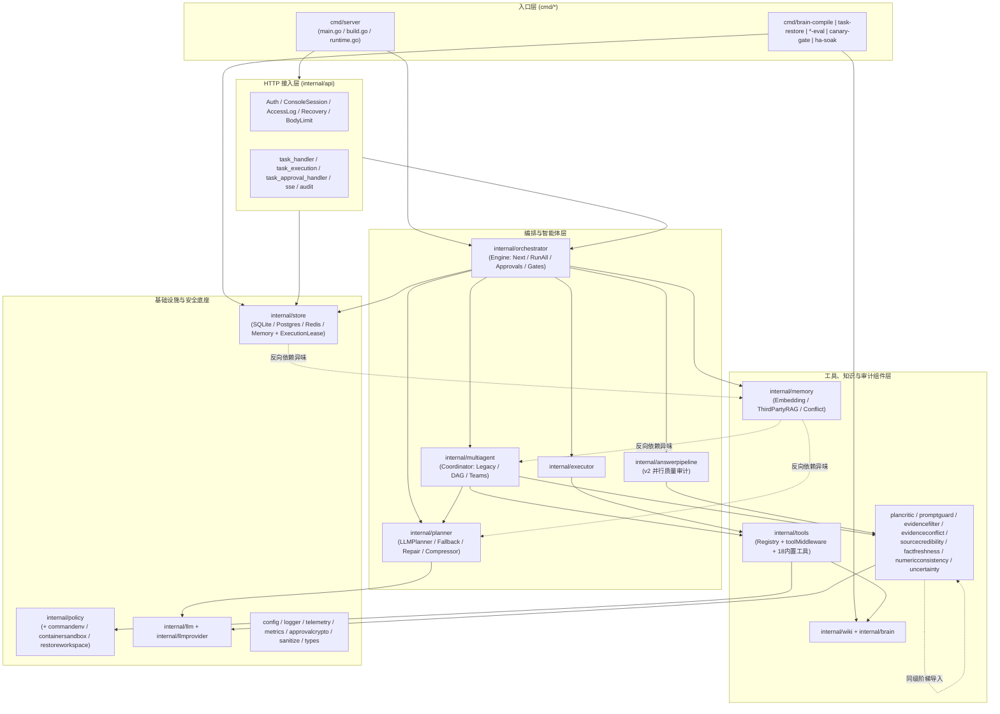
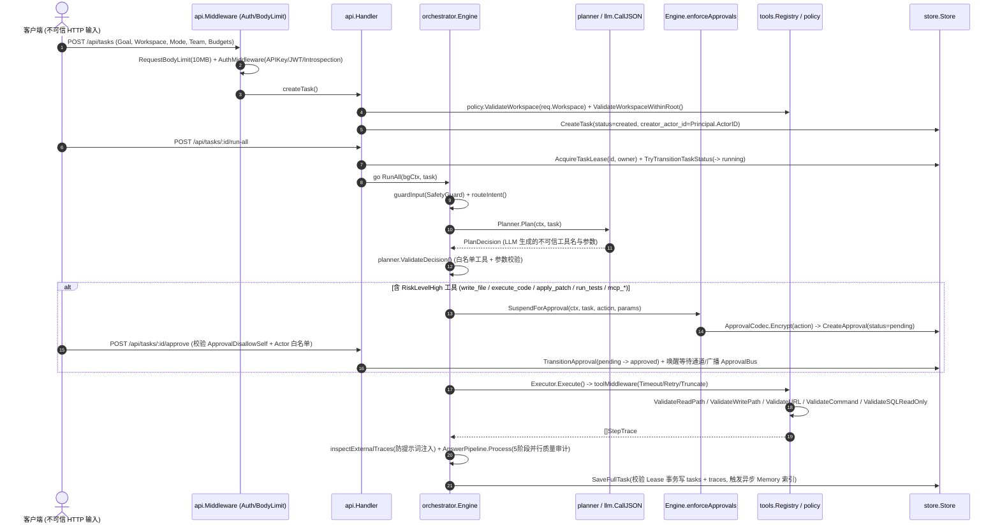

# AI-Agent 代码质量与安全审计报告（2026-10-15）

---

## 1. 总体结论与风险评分

* **总体结论**：本项目（`github.com/wuxujun/ai-agent`，Go 1.26.8）整体工程化水准较高，核心路径已具备多租户隔离、工作区防穿越、SSRF 防私网拨号、高风险工具人工审批（AES-256-GCM 密文落库）、CAS 状态机与丰富的竞态测试（7.4 万行生产代码配比 5.8 万行测试代码）。但通过全链路数据流追踪，仍发现 **5 个 P1 级高危缺陷/安全漏洞**（涵盖第三方 RAG MCP 握手 SSRF 与凭据泄露、`awaiting_approval` 状态机死锁、持久审批恢复绕过预算与防注入检查、`re-audit` 租约校验失效、`read_file` 无上限读取 OOM 与 UTF-8 截断损坏）及 **6 个 P2/P3 级并发、数据一致性与架构债务问题**。
* **综合风险评分**：**5.8 / 10（中风险，修复 5 项 P1 问题后可降至 2.5 / 10 低风险生产就绪水平）**。

---

## 2. 第 0 步：全局认知与任务一：代码分析

### 2.1 技术栈、构建配置与工具链检查结果
* **模块与依赖**（`go.mod:1-29`）：`module github.com/wuxujun/ai-agent`，Go 版本 `1.26.8`。直接依赖包括 `gin-gonic/gin v1.12.0`、`cloudwego/eino v0.9.2`、`google.golang.org/adk v1.3.0`、`google.golang.org/genai v1.58.0`、`golang-jwt/jwt/v5 v5.3.1`、`lib/pq v1.12.3`、`redis/go-redis/v9 v9.20.0`、`modernc.org/sqlite v1.50.1`、`spf13/viper v1.21.0`、`fsnotify v1.9.0`、`go.opentelemetry.io/otel v1.44.0`。
* **入口、容器与 CI 配置**：
  * 主服务入口：`cmd/server/main.go:83`（`run()`）-> `cmd/server/build.go:40`（`buildApp()`）-> `cmd/server/runtime.go:42`（`runApp()`）。
  * 容器沙箱镜像：`deploy/security/execution-image/Dockerfile:1-15`（用于 `tool.sandbox.mode: docker` 的受限工具运行镜像）；编排栈位于 `deploy/ha/compose.yaml`、`deploy/litellm/compose.yaml`、`deploy/opentelemetry/docker-compose.yml`。
  * CI/Release：`.github/workflows/ci.yml:1-155`（含 `gofmt`、`go vet`、`go test`、`go test -race`、Playwright 三浏览器矩阵、`gitleaks v8.27.2`、`govulncheck v1.8.0`、Postgres+pgvector+Redis 集成测试）；`.github/workflows/release.yml:1-106`（五平台 `CGO_ENABLED=0` 交叉编译）。
* **Go 工具链执行说明**：
  * 当前审计运行在受限沙箱内，本机 Go 工具链位于仓库外的 `/Users/xujunwu/GoProject/pkg/mod/golang.org/toolchain@v0.0.1-go1.26.8.darwin-amd64/bin/go`，沙箱访问该路径返回 `Operation not permitted`，因此实时调用 `go build`/`go vet`/`staticcheck`/`gosec`/`govulncheck`/`go test` 跳过并标记为**待验证**。
  * 交叉核对本机最新缓存测试日志 `/private/tmp/ai-agent-c03-matrix-complete-full-20261014.log` 与 `/private/tmp/ai-agent-c03-matrix-complete-race-20261014.log`：全仓 60 个包单测及核心 7 包 `-race` 均显示 `ok`/PASS。

### 2.2 模块依赖图与核心调用链（Mermaid）



### 2.3 核心调用时序图（不可信输入 -> 规划 -> 审批门禁 -> 敏感工具执行 -> 审计落库）



### 2.4 代码规范性评估（分层、错误处理、日志、配置、Context、可测试性）
1. **架构分层与依赖方向**：
   * 全仓 60 个包**无循环依赖**，底层 `internal/types`（`internal/types/task.go` 等 7 文件）保持 0 内部依赖。
   * **分层瑕疵**：`internal/store` 导入了 `internal/memory`（`internal/store/sqlite.go:15`），而 `internal/memory/memory.go:14-15` 又导入了 `internal/multiagent` 与 `internal/planner`，造成存储层间接依赖上层编排；此外 `internal/uncertainty/calibrator.go:9-15` 等 6 个同级质量审计包存在阶梯式互相导入。
2. **错误处理与日志规范**：
   * 绝大多数错误使用 `fmt.Errorf("...: %w", err)` 包装并支持 `errors.Is/As`。
   * `internal/logger/logger.go:75-179` 实现了属性级自动脱敏拦截器（`safeLogAttr`），对 `api_key`, `authorization`, `dsn`, `password`, `token` 等键强制替换为 `[REDACTED]`，对 `goal`, `prompt`, `observation`, `body` 等内容键仅记录 `<N chars>` 长度，安全意识极强。
3. **配置与 Context 传递**：
   * 配置通过 `config.Get()` 原子读取快照（`internal/config/config.go`），支持事务性 `Reload()` 校验。
   * Context 贯穿 HTTP -> Engine -> Coordinator -> LLM -> Tool -> SQL/Redis，且自定义了 `WithPausableTimeout`（`internal/orchestrator/execution_timeout.go:34`）在人工审批挂起期间冻结超时倒计时，设计精巧。
   * **Context 瑕疵**：`internal/store/memory.go:261,279,309` 等多处方法签名将 `ctx` 写成 `_ context.Context` 忽略取消信号；`startDurableApprovalRecovery`（`internal/api/task_approval_handler.go:254`）使用 `context.Background()` 脱离了服务退出信号。
4. **测试覆盖与可测试性**：
   * 314 个生产文件（74,191 行）配有 339 个测试文件（58,352 行），仅 `cmd/canary-gate`, `cmd/ha-soak`, `cmd/multiagent-eval`, `cmd/rag-eval-stub`, `internal/vision` 无独立 `_test.go` 文件；大量使用 fake、表驱动测试、`t.TempDir()` 与子进程崩溃矩阵，可测试性优秀。

---

## 3. 任务二 & 任务四：问题清单总表（BUG 发现与安全风险审计）

| ID | 严重度 | 类别 | 位置 (`文件:行号`) | 问题描述与数据流 | 可利用性与影响范围 | 修复建议摘要 |
| :--- | :---: | :--- | :--- | :--- | :--- | :--- |
| **BUG-01** | **P1** | 安全 (SSRF / 凭据泄露 / 跨租户污染) | `internal/memory/rag_search.go:22-28, 453-464, 484-518` | 1. `queryMCP` 解析不可信 SSE `endpoint` 事件时直接执行 `base.Parse(endpointURL)`（456行），未校验与 `ragURL` 同源（Scheme+Host），随后将 `cfg.RAG.Authorization` Bearer 密钥发往 `postURL`；<br>2. `ragHTTPClient`（22行）未使用 `policy.ConfiguredHTTPClient` 防私网拨号，且作为全局单例挂载了共享 `cookiejar.New(nil)`。 | **可利用性：中-高**（当接入外部/租户自定义 MCP RAG 或上游被劫持时）。<br>**影响**：内网/云元数据 SSRF、`RAG.Authorization` 密钥外泄、多租户共享 CookieJar 串号。 | 1. 校验 `resolvedURL.Scheme == base.Scheme && resolvedURL.Host == base.Host`；<br>2. 改用 `policy.SafeHTTPClient` 并禁止自动跟随跨源重定向，移除全局共享 CookieJar。 |
| **BUG-02** | **P1** | 逻辑 (状态机死锁) | `internal/api/task_execution.go:494-543`<br>`internal/api/task_handler.go:303-309` | 服务重启或流断开后，开启持久审批的任务在 DB 中保持 `status = "awaiting_approval"` 且不在内存 `activeTasks` 中。此时调 `DELETE /api/tasks/:id` 被 `task_handler.go:303` 拦截（409 要求先 cancel）；而调 `DELETE /api/tasks/:id/cancel` 在 `task_execution.go:530` 仅判断 `task.Status == types.StatusRunning`，返回 400 `"task is not running"`。 | **可利用性：高**（常规运维重启或单步执行挂起后必现）。<br>**影响**：任务陷入既无法取消又无法删除的死锁状态，且残留 `pending` 审批无法随取消失效。 | 在 `cancelTask` 的 DB 兜底分支允许取消 `StatusRunning`、`StatusAwaitingApproval`、`StatusPaused` 任务，并同步将该任务的 `pending` 持久审批置为 `expired`。 |
| **BUG-03** | **P1** | 逻辑 & 安全 (门禁绕过 / 预算逃逸) | `internal/orchestrator/engine_approvals.go:46-48, 349-386` | `RecoverApprovedApproval` 恢复执行高风险工具时：<br>1. 审批人覆盖的 `resolution.Parameters`（349行）未重新经过工具 `Validate` / `planner.ValidateDecision` 校验；<br>2. 执行后未扣减 `task.ToolBudget -= len(traces)`（366行）；<br>3. 未调用 `inspectExternalTraces` / `filterExternalTraces` / `resolveEvidenceConflicts`（对比 `engine_lifecycle.go:356-380`）。 | **可利用性：中-高**（所有走持久审批恢复的高风险动作必触发）。<br>**影响**：工具预算失效、审批覆盖参数可绕过路径/格式校验、高风险 MCP 工具输出绕过 Prompt 注入检测。 | 在 `enforceApprovals` 与 `RecoverApprovedApproval` 执行前调用 `planner.ValidateDecision` 校验替换后的参数，执行后补齐 `inspectExternalTraces` 等三道证据审计并扣减 `task.ToolBudget`。 |
| **BUG-04** | **P1** | 并发 & 数据库 (租约校验失效 / 脏写覆盖) | `internal/api/audit.go:268-309`<br>`internal/store/task_lease_sql.go:27-31` | `reauditTask` 在 `taskSem.Acquire`（281行）和 `AcquireTaskLease`（287行）之前读取 `task`（268行），获锁后既未重新 `GetTask`，也未调用 `ctx = store.WithTaskLease(ctx, task.ID, owner)`。导致 `SaveFullTask(ctx, task)`（306行）在 `guardTaskLeaseSQL` 中因 `scoped == false` 完全跳过租约校验。 | **可利用性：中**（并发调用 `re-audit` 或 LLM 审计超时场景）。<br>**影响**：租约过期后仍能无锁覆盖 DB，且用排队前的旧 `task` 快照回写覆盖期间的新状态。 | 在 `AcquireTaskLease` 成功后立即注入 `ctx = store.WithTaskLease(ctx, task.ID, owner)` 并重新 `h.store.GetTask(ctx, task.ID)`。 |
| **BUG-05** | **P1** | 资源 & 安全 (OOM / TOCTOU / UTF-8 截断损坏) | `internal/tools/read.go:44-77`<br>`internal/tools/write.go:67-86` | 1. `ReadFile`（`read.go:69`）直接 `os.ReadFile(full)` 全量读入内存后再截断前 4000 字节，读取大文件或命名管道会直接 OOM；<br>2. `b[:4000]` 按字节硬切存入 `Evidence[0].Lines[0]`（未走 `truncateToolObservation`），截断中文等多字节 UTF-8 时产生非法字节序列；<br>3. `read.go` 未用 `O_NOFOLLOW`/`os.OpenRoot`，`write.go:73` 的 `os.MkdirAll` 未防中间目录符号链接替换（TOCTOU）。 | **可利用性：高**（LLM 读取工作区内大文件或 >4KB 中文文件即触发）。<br>**影响**：单次 `read_file` 可致服务 OOM 崩溃；非法 UTF-8 污染 Trace Evidence；存在符号链接竞争窗口。 | 使用 `os.OpenRoot(workspace)` 配合 `io.LimitReader(f, 4001)` 读取 regular file，并回退到合法 UTF-8 字符边界。 |
| **BUG-06** | **P2** | 并发 (Goroutine 泄漏 / 关闭后访问) | `internal/store/sqlite.go:636`<br>`internal/store/postgres.go:614`<br>`internal/store/redis.go:478`<br>`internal/store/memory.go:203`<br>`internal/api/task_approval_handler.go:248-315` | 1. 四个 Store 在 `saveFullTask` 终态时启动的异步记忆索引 `go func()`（最长 30s）均未纳入 `WaitGroup`，服务退出 `st.Close()` 后协程继续调用 `SaveMemory` 访问已关闭的 DB/Redis；<br>2. `startDurableApprovalRecovery` 默认模式下（`token == nil`）使用 `context.Background()`（254行），`Handler.Shutdown()` 无法取消它，阻塞 `h.Wait()` 排空。 | **可利用性：中**（服务滚动发布/重启期间有刚完成的任务或跨节点审批恢复时触发）。<br>**影响**：退出日志报错、最后一批任务记忆丢失、优雅停机被迫等待 10s 超时。 | 在 Store 中增加 `wg sync.WaitGroup` 并在 `Close()` 中等待索引协程完成；将 `Handler` 级 shutdown context 传入 `startDurableApprovalRecovery`。 |
| **BUG-07** | **P2** | 数据库 (孤儿数据残留) | `internal/store/sqlite.go:47-54, 964-1015`<br>`internal/store/memory.go:261-293`<br>`internal/store/redis.go:160-192` | 1. `NewSQLiteStore` 未执行 `PRAGMA foreign_keys = ON;`，且 `SQLiteStore.DeleteTask` / `DeleteAllTasks` 未执行 `DELETE FROM approvals WHERE task_id = ?`，导致外键级联不生效、审批表永久残留孤儿行；<br>2. `MemoryStore` 与 `RedisStore` 删除任务时同样未清理关联 `approvals` 及 `memories:session:*` 索引。 | **可利用性：中**（调用删除任务 API 时必现）。<br>**影响**：租户审批收件箱（`ListApprovals`）与统计（`GetApprovalStats`）残留已删除任务的幽灵审批记录。 | 在 `NewSQLiteStore` 开启 `PRAGMA foreign_keys = ON;`，并在 SQLite/Postgres/Memory/Redis 的 `DeleteTask`/`DeleteAllTasks` 中显式清理 `approvals` 与会话记忆索引。 |
| **BUG-08** | **P2** | 安全 & 资源 (无界读取 / HTTP 客户端策略) | `internal/promptmanager/client.go:90-95, 305-313`<br>`internal/api/jwt.go:51-55`<br>`internal/config/config.go:1557` | 1. `PromptManager.fetchFromLangfuse`（310行）直接 `json.NewDecoder(resp.Body).Decode` 无 `io.LimitReader` 限制，且 `pm.client` 未禁重定向（BasicAuth 凭据风险）；<br>2. `jwtVerifier`（`jwt.go:53`）使用普通 `telemetry.NewHTTPClient` 而非 `policy.ConfiguredHTTPClient`，且允许 `http://` 明文 JWKS URL。 | **可利用性：低-中**（需配置错误或上游网关异常）。<br>**影响**：超大响应消耗内存，JWKS 端点缺少与 Introspection 对齐的私网 DNS 重绑定防护。 | 为 `promptmanager` 增加 `io.LimitReader(resp.Body, 1<<20)` 与禁止跨源重定向；`jwtVerifier` 统一使用 `policy.ConfiguredHTTPClient`。 |
| **BUG-09** | **P2** | 性能 & 数据库 (全表扫描 / 启动漏扫) | `internal/api/audit.go:63-135, 233-249`<br>`cmd/server/build.go:146-156` | 1. `/api/audits` 与 `/api/audits/summary` 通过 `scanTasks` 循环分页把全表所有 Task（含大文本 JSON 列）拉到内存过滤；<br>2. `startPausedTaskScan`（`build.go:146`）仅查询前 500 条 `StatusFailed` 任务（按 `id ASC`），当历史失败任务 >500 条时会漏扫新中断的可恢复任务。 | **可利用性：中**（随运行时间推移数据量增长后必现）。<br>**影响**：审计接口延时与内存分配随历史任务数线性恶化；启动恢复漏扫。 | 为 SQL 后端增加按 `answer_audit_json` 摘要列或下推 SQL 条件查询；启动扫描增加分页或按 `termination_kind` 过滤。 |
| **BUG-10** | **P3** | 运维 (热重载不一致) | `internal/api/config_handler.go:21-26`<br>`cmd/server/main.go:223-225` | `POST /api/config/reload` 与 `config.Watch` 回调在重载配置后仅调用了 `ResizeTaskSemaphore`，未像 `SIGHUP`（`main.go:243`）那样调用 `logger.Configure`。 | **可利用性：低**。<br>**影响**：通过 HTTP API 或修改文件热重载 `log.level` 等日志配置不生效。 | 在 `reloadConfig` 与 `config.Watch` 回调中同步调用日志重配逻辑。 |
| **BUG-11** | **P3** | 架构 (死代码与依赖倒挂) | `internal/workspace/`<br>`internal/authorityledger/`<br>`internal/memory/memory.go:14-15`<br>`internal/uncertainty/calibrator.go:9-15` | 1. `internal/workspace` 已标记 `Deprecated` 且零引用；`internal/authorityledger`（1,020行）零引用；<br>2. `store -> memory -> multiagent/planner` 逆向依赖；6 个同级审计包阶梯式互相导入。 | **可利用性：无（维护性风险）**。<br>**影响**：增加编译耦合与维护认知负担。 | 下沉公共 `TraceAction` 常量至 `internal/types`，解耦 `memory` 对 `multiagent` 的导入，清理废弃包。 |

---

## 4. P0 / P1 问题关键代码证据与 Diff 修复方案

### 4.1 [BUG-01 | P1] 第三方 RAG MCP SSE 握手同源校验缺失、SSRF 与跨租户 CookieJar 共享
* **证据代码**（`internal/memory/rag_search.go:22-28, 453-464`）：
```go
// internal/memory/rag_search.go:22-28
var ragHTTPClient = func() *http.Client {
	jar, _ := cookiejar.New(nil)
	return telemetry.InstrumentHTTPClient(&http.Client{
		Timeout: 10 * time.Second,
		Jar:     jar,
	})
}()
// internal/memory/rag_search.go:453-464
		if readErr == nil && endpointURL != "" {
			base, parseErr := url.Parse(ragURL)
			if parseErr == nil {
				resolvedURL, parseErr := base.Parse(endpointURL)
				if parseErr == nil {
					postURL := resolvedURL.String()
					log.Info("MCP SSE endpoint resolved", "task_id", logger.TaskID(ctx), "post_url", postURL)
					return doMCPHandshakeAndCall(ctx, postURL, auth, query, initialHeaders)
				}
			}
		}
```
* **修复 Diff**：
```diff
--- a/internal/memory/rag_search.go
+++ b/internal/memory/rag_search.go
@@ -14,17 +14,22 @@ import (
 	"github.com/wuxujun/ai-agent/internal/config"
 	"github.com/wuxujun/ai-agent/internal/logger"
+	"github.com/wuxujun/ai-agent/internal/policy"
 	"github.com/wuxujun/ai-agent/internal/telemetry"
 
 	"github.com/wuxujun/ai-agent/internal/types"
 )
 
 var ragHTTPClient = func() *http.Client {
-	jar, _ := cookiejar.New(nil)
-	return telemetry.InstrumentHTTPClient(&http.Client{
-		Timeout: 10 * time.Second,
-		Jar:     jar,
-	})
+	client := policy.SafeHTTPClient(10 * time.Second)
+	client.CheckRedirect = func(*http.Request, []*http.Request) error {
+		return http.ErrUseLastResponse
+	}
+	return client
 }()
+
+func sameOriginURL(base, target *url.URL) bool {
+	return base != nil && target != nil && strings.EqualFold(base.Scheme, target.Scheme) && strings.EqualFold(base.Host, target.Host) && target.User == nil
+}
 
 // SearchThirdPartyRAG queries an external/third-party RAG URL to retrieve relevant historical memories/knowledge.
 func SearchThirdPartyRAG(ctx context.Context, query string) ([]types.Memory, error) {
@@ -454,7 +459,7 @@ func queryMCP(ctx context.Context, ragURL, auth, query string) ([]types.Memory,
 			base, parseErr := url.Parse(ragURL)
 			if parseErr == nil {
 				resolvedURL, parseErr := base.Parse(endpointURL)
-				if parseErr == nil {
+				if parseErr == nil && sameOriginURL(base, resolvedURL) {
 					postURL := resolvedURL.String()
 					log.Info("MCP SSE endpoint resolved", "task_id", logger.TaskID(ctx), "post_url", postURL)
 					return doMCPHandshakeAndCall(ctx, postURL, auth, query, initialHeaders)
```

---

### 4.2 [BUG-02 | P1] `awaiting_approval` 任务的取消与删除状态机死锁修复
* **证据代码**（`internal/api/task_execution.go:530-543` 与 `internal/api/task_handler.go:303-309`）：
```go
// internal/api/task_handler.go:303
	if task.Status == types.StatusRunning || task.Status == types.StatusAwaitingApproval {
		c.JSON(http.StatusConflict, gin.H{
			"error":   "task must be cancelled before deletion",
			"task_id": taskID,
			"status":  task.Status,
		})
		return
	}
// internal/api/task_execution.go:530
	if task.Status == types.StatusRunning {
		if err := orchestrator.SetTaskCanceled(task, "task_canceled", "Task was canceled via API."); err != nil {
...
	}
	c.JSON(http.StatusBadRequest, gin.H{"error": "task is not running", "status": task.Status})
```
* **修复 Diff**：
```diff
--- a/internal/api/task_execution.go
+++ b/internal/api/task_execution.go
@@ -527,13 +527,31 @@ func (h *Handler) cancelTask(c *gin.Context) {
 		return
 	}
 
-	if task.Status == types.StatusRunning {
+	if task.Status == types.StatusRunning || task.Status == types.StatusAwaitingApproval || task.Status == types.StatusPaused {
+		owner := "cancel-" + uuid.NewString()
+		acquired, leaseErr := h.store.AcquireTaskLease(ctx, task.ID, owner, 10*time.Second)
+		if leaseErr != nil {
+			c.Error(leaseErr)
+			return
+		}
+		if !acquired {
+			c.JSON(http.StatusConflict, gin.H{"error": "task is currently leased by another instance", "task_id": taskID})
+			return
+		}
+		defer func() {
+			releaseCtx, cancel := context.WithTimeout(context.Background(), 3*time.Second)
+			defer cancel()
+			_ = h.store.ReleaseTaskLease(releaseCtx, task.ID, owner)
+		}()
+		ctx = store.WithTaskLease(ctx, task.ID, owner)
+		if durableStore, ok := h.store.(store.DurableApprovalStore); ok {
+			tenantID := task.TenantID
+			if tenantID == "" {
+				tenantID = "default"
+			}
+			pending, _ := durableStore.ListTaskApprovals(ctx, task.ID, tenantID, types.ApprovalPending)
+			for _, rec := range pending {
+				_, _ = durableStore.TransitionApproval(ctx, rec.ID, tenantID, rec.Version, types.ApprovalPending, types.ApprovalExpired, rec.ResolutionPayload)
+			}
+		}
 		if err := orchestrator.SetTaskCanceled(task, "task_canceled", "Task was canceled via API."); err != nil {
 			c.Error(err)
 			return
 		}
 		if saveErr := h.store.SaveFullTask(ctx, task); saveErr != nil {
 			c.Error(saveErr)
 			return
 		}
```

---

### 4.3 [BUG-03 | P1] `RecoverApprovedApproval` 补齐参数重校验、预算扣减与外部证据防注入审计
* **证据代码**（`internal/orchestrator/engine_approvals.go:349-374`）：
```go
	if resolution.Parameters != nil {
		action.Parameters = resolution.Parameters
	}
	if err := recoveryExecutionError(ctx); err != nil {
		return false, err
	}
	consumed, err := durableStore.TransitionApproval(ctx, latest.ID, latest.TenantID, latest.Version, types.ApprovalApproved, types.ApprovalConsumed, latest.ResolutionPayload)
...
	traces, executeErr := e.Executor.Execute(ctx, task, &planner.PlanDecision{Actions: []planner.ActionCall{action}})
	task.Trace = append(task.Trace, traces...)
	task.StepCount += len(traces)
	task.Status = types.StatusPaused
```
* **修复 Diff**：
```diff
--- a/internal/orchestrator/engine_approvals.go
+++ b/internal/orchestrator/engine_approvals.go
@@ -43,6 +43,12 @@ func (e *Engine) enforceApprovals(ctx context.Context, task *types.Task, decisio
 		if !approved {
 			return true, nil
 		}
 		if newParams != nil {
 			ac.Parameters = newParams
+			if err := planner.ValidateDecision(&planner.PlanDecision{Actions: []planner.ActionCall{*ac}}); err != nil {
+				return false, fmt.Errorf("invalid replacement parameters from approval: %w", err)
+			}
 		}
 	}
 	return false, executionLeaseError(ctx)
 }
@@ -348,6 +354,10 @@ func (e *Engine) RecoverApprovedApproval(ctx context.Context, task *types.Task,
 	if resolution.Parameters != nil {
 		action.Parameters = resolution.Parameters
 	}
+	decision := &planner.PlanDecision{Actions: []planner.ActionCall{action}}
+	if err := planner.ValidateDecision(decision); err != nil {
+		return false, fmt.Errorf("invalid approved action parameters: %w", err)
+	}
 	if err := recoveryExecutionError(ctx); err != nil {
 		return false, err
 	}
@@ -362,9 +372,18 @@ func (e *Engine) RecoverApprovedApproval(ctx context.Context, task *types.Task,
 	if err := recoveryExecutionError(ctx); err != nil {
 		return true, err
 	}
-	traces, executeErr := e.Executor.Execute(ctx, task, &planner.PlanDecision{Actions: []planner.ActionCall{action}})
+	traces, executeErr := e.Executor.Execute(ctx, task, decision)
+	traces, injectionAudit := e.inspectExternalTraces(ctx, task, traces)
+	traces, relevanceAudits := e.filterExternalTraces(ctx, task, traces)
+	conflictAudits := e.resolveEvidenceConflicts(ctx, task, traces)
 	task.Trace = append(task.Trace, traces...)
+	if injectionAudit != nil {
+		task.Trace = append(task.Trace, *injectionAudit)
+	}
+	task.Trace = append(task.Trace, relevanceAudits...)
+	task.Trace = append(task.Trace, conflictAudits...)
 	task.StepCount += len(traces)
+	task.ToolBudget -= len(traces)
 	task.Status = types.StatusPaused
```

---

### 4.4 [BUG-04 | P1] `reauditTask` 注入 `WithTaskLease` 并在获锁后重载最新 Task 快照
* **证据代码**（`internal/api/audit.go:286-309`）：
```go
	owner := "reaudit-" + uuid.NewString()
	acquired, err := h.store.AcquireTaskLease(ctx, task.ID, owner, time.Duration(timeout+30)*time.Second)
	if err != nil {
		c.Error(err)
		return
	}
	if !acquired {
		c.JSON(http.StatusConflict, gin.H{"error": "task is active on another instance", "task_id": task.ID})
		return
	}
	...
	report, err := h.engine.Reaudit(ctx, task, request.Force)
	if err != nil {
		c.JSON(http.StatusUnprocessableEntity, gin.H{"error": err.Error()})
		return
	}
	if err := h.store.SaveFullTask(ctx, task); err != nil {
```
* **修复 Diff**：
```diff
--- a/internal/api/audit.go
+++ b/internal/api/audit.go
@@ -299,6 +299,21 @@ func (h *Handler) reauditTask(c *gin.Context) {
 			log.Warn("failed to release re-audit lease", "task_id", task.ID, "error", releaseErr)
 		}
 	}()
+	ctx = store.WithTaskLease(ctx, task.ID, owner)
+	freshTask, err := h.store.GetTask(ctx, task.ID)
+	if err != nil {
+		c.Error(err)
+		return
+	}
+	task = freshTask
+	if !types.IsTerminalTaskStatus(task.Status) {
+		c.JSON(http.StatusConflict, gin.H{"error": "only terminal tasks can be re-audited"})
+		return
+	}
+	if strings.TrimSpace(task.FinalAnswer) == "" {
+		c.JSON(http.StatusUnprocessableEntity, gin.H{"error": "task has no answer to audit"})
+		return
+	}
 	report, err := h.engine.Reaudit(ctx, task, request.Force)
 	if err != nil {
 		c.JSON(http.StatusUnprocessableEntity, gin.H{"error": err.Error()})
```

---

### 4.5 [BUG-05 | P1] `read_file` 有界安全读取（防 OOM、防 TOCTOU、防 UTF-8 截断损坏）
* **证据代码**（`internal/tools/read.go:44-77`）：
```go
func (t *ReadFileTool) Execute(ctx context.Context, workspace string, params map[string]interface{}) (*ToolResult, error) {
	path, _ := params["path"].(string)
	content, err := ReadFile(workspace, path)
...
func ReadFile(workspace string, relativePath string) (string, error) {
	full := filepath.Join(workspace, relativePath)
	if err := policy.ValidateReadPath(workspace, full); err != nil {
		return "", err
	}

	b, err := os.ReadFile(full)
	if err != nil {
		return "", err
	}

	if len(b) > 4000 {
		b = b[:4000]
	}
	return string(b), nil
}
```
* **修复 Diff**：
```diff
--- a/internal/tools/read.go
+++ b/internal/tools/read.go
@@ -3,9 +3,11 @@ package tools
 import (
 	"context"
 	"fmt"
-	"github.com/wuxujun/ai-agent/internal/types"
+	"io"
 	"os"
 	"path/filepath"
 	"strings"
+	"unicode/utf8"
 
 	"github.com/wuxujun/ai-agent/internal/policy"
+	"github.com/wuxujun/ai-agent/internal/types"
 )
@@ -42,6 +44,12 @@ func (t *ReadFileTool) Validate(params map[string]any) error {
 }
 
 func (t *ReadFileTool) Execute(ctx context.Context, workspace string, params map[string]interface{}) (*ToolResult, error) {
+	if err := t.Validate(params); err != nil {
+		return nil, err
+	}
+	if err := policy.ValidateWorkspace(workspace); err != nil {
+		return nil, fmt.Errorf("read_file policy violation: %w", err)
+	}
 	path, _ := params["path"].(string)
 	content, err := ReadFile(workspace, path)
 	if err != nil {
@@ -62,15 +70,38 @@ func init() {
 }
 
 func ReadFile(workspace string, relativePath string) (string, error) {
+	const maxReadBytes = 4000
 	full := filepath.Join(workspace, relativePath)
 	if err := policy.ValidateReadPath(workspace, full); err != nil {
 		return "", err
 	}
-
-	b, err := os.ReadFile(full)
+	rel, err := filepath.Rel(workspace, full)
+	if err != nil {
+		return "", err
+	}
+	root, err := os.OpenRoot(workspace)
+	if err != nil {
+		return "", err
+	}
+	defer root.Close()
+	info, err := root.Lstat(rel)
+	if err != nil {
+		return "", err
+	}
+	if !info.Mode().IsRegular() {
+		return "", fmt.Errorf("read_file target %q is not a regular file", relativePath)
+	}
+	f, err := root.Open(rel)
 	if err != nil {
 		return "", err
 	}
+	defer f.Close()
+	b, err := io.ReadAll(io.LimitReader(f, maxReadBytes+1))
+	if err != nil {
+		return "", err
+	}
 	if len(b) > 4000 {
 		b = b[:4000]
+		for len(b) > 0 && !utf8.Valid(b) {
+			b = b[:len(b)-1]
+		}
 	}
-	return string(b), nil
+	return strings.ToValidUTF8(string(b), "\uFFFD"), nil
 }
```

---

## 5. 任务三：功能进度核对表与未接入/死代码盘点

### 5.1 功能完成度对照表（对照 `README.md` 与 `docs/` 设计文档）

| 功能点 | 状态 | 证据 (`文件:行号`) | 当前缺口 | 预估收尾工作量 |
| :--- | :---: | :--- | :--- | :--- |
| **1. 单智能体多模式编排 (`eino`/`legacy`/`adk`/`step`)** | **已完成** | `internal/orchestrator/engine_lifecycle.go:27-450`<br>`internal/orchestrator/eino.go:1-380`<br>`internal/orchestrator/adk.go:1-420` | 生产可直接使用 | 0 天 |
| **2. Multi-Agent 双工作流与 Adaptive 路由** | **已完成** | `internal/multiagent/coordinator.go:93-360`<br>`internal/multiagent/adaptive_workflow_runtime.go:1-120`<br>`teams.yaml:1-250` | 生产可直接使用 | 0 天 |
| **3. Multi-Agent DAG 拓扑并发运行时与 Canary 分桶** | **部分完成 (代码完成/配置未启用)** | `internal/multiagent/workflow_graph.go:42-230`<br>`internal/multiagent/runtime_canary.go:1-120`<br>`config.yaml:184-185` | 代码与单测已完备，但 `config.yaml` 默认 `runtime: legacy`, `dag_canary_percent: 0`，缺线上灰度放量验收 | 2-3 天（灰度观测） |
| **4. 多模型提供方、按场景路由、熔断器与成本账本** | **已完成** | `internal/llm/transport.go:25-180`<br>`internal/llm/resilience.go:34-180`<br>`internal/llm/budget.go:40-210` | `config.yaml:283-336` 默认注释了 22 个可选场景，需按实际预算开启 | 0.5 天（配置调优） |
| **5. 高风险工具持久审批、AES-GCM 轮换与禁止自批** | **有小缺陷 (见 BUG-02/03)** | `internal/orchestrator/engine_approvals.go:20-470`<br>`internal/approvalcrypto/`<br>`internal/api/approval_policy.go:1-80` | 需修复 `BUG-02`（`awaiting_approval` 取消死锁）、`BUG-03`（恢复路径漏扣预算与校验）及 `BUG-07`（删除任务级联清理） | 1 天 |
| **6. 答案质量流水线 (5 阶段并行审计)** | **已完成 (默认 observe)** | `internal/answerpipeline/pipeline_v2.go:1-250`<br>`config.yaml:188-206` | 默认处于 `enforcement: observe` 且依赖的 LLM 场景在 `config.yaml` 中未取消注释；`re-audit` 需修 `BUG-04` | 1 天 |
| **7. 只读 LLM Wiki (本地 BM25/图谱 + 远程 MCP + 64MB 缓存)** | **已完成** | `internal/wiki/`<br>`internal/tools/wiki.go:1-250`<br>`internal/tools/wiki_cache_budget.go:1-150` | 生产可直接使用 | 0 天 |
| **8. Brain 编译型只读知识库与 CLI 快照发布** | **已完成 (默认关闭)** | `internal/brain/` (15 文件 / 4,344 行)<br>`cmd/brain-compile/main.go:1-233`<br>`config.yaml:115-124` | 代码与评测门禁已完备，`config.yaml:116` 默认 `enabled: false` | 0.5 天（按需开启） |
| **9. 内嵌 Web Console (`/console`) 与 CSRF/Cookie 会话** | **部分完成 (待重启联调)** | `internal/api/console_session.go:1-235`<br>`internal/api/console_assets.go:1-45`<br>`docs/Web-UI发布前检查与登录排障_2026-10-14.md:1-75` | 代码已实现，待重启加载 `.env` 中的 `AI_AGENT_CONSOLE_SESSION_KEY` 并完成真实 Token 登录与三浏览器复验 | 0.5-1 天 |
| **10. 工具 Docker 容器沙箱隔离** | **部分完成 (默认 local)** | `internal/policy/containersandbox/` (5 文件 / 766 行)<br>`config.yaml:599-609` | 本机 Docker live 测试已通过，但默认 `local`；缺生产宿主机磁盘配额与崩溃后孤儿容器启动对账 | 2 天 |
| **11. Task 联合快照导出与离线恢复准入控制面** | **部分完成 (已暂缓)** | `internal/store/task_restore_admission.go:1-260`<br>`internal/store/task_restore_admission_persistent.go:1-310`<br>`cmd/task-restore/main.go:1-198` | 9 类强制证据检查器仅实现了 `workspace` 与 `key_management` 2 类，其余 7 类未实现，恢复固定返回 `blocked` | 5-8 天（已移入待优化） |
| **12. 双节点 HA 部署与 Soak 压测** | **部分完成 (已延后)** | `deploy/ha/compose.yaml`<br>`cmd/ha-soak/main.go`<br>`internal/hasoak/` | 仅跑过 31 分钟短时验证，缺完整 1 小时故障注入与租约失联 fencing 验收 | 2-3 天 |

### 5.2 TODO/FIXME、桩函数、Mock 残留、死代码与未接入模块清单
1. **TODO / FIXME / HACK 统计**：
   * 全仓 `.go` 文件中**无未完成的开发 TODO/FIXME**（仅 `internal/multiagent/writer_agent.go:26` 的系统提示词文本及 `internal/multiagent/multiagent_test.go:56-58` 测试夹具包含 `"TODO"` 字符串）。
2. **废弃死代码（Dead Code）**：
   * `internal/workspace`（`internal/workspace/doc.go:9`、`internal/workspace/sandbox.go:9,15,25`）：共 3 个生产文件（151 行），已明确标注 `// Deprecated: use internal/tools.Registry with internal/orchestrator.Engine`，全仓无任何非测试包引用。
   * `internal/api/router.go:1`：仅包含 `package api` 单行空文件（12 字节），无任何代码。
3. **已编写但未接入生产运行时的模块（Unwired Modules）**：
   * `internal/authorityledger`（3 个生产文件 / 1,020 行）：SQLite 版本账本原型，**全仓没有任何非测试包 import 该包**。
   * `internal/api/sqlite_owned_step.go`（`Handler.ownedSQLiteStep`）、`internal/api/sqlite_owned_all.go`（`Handler.ownedSQLiteRunAll`）、`internal/orchestrator/approval_recovery_dispatch.go`（`Engine.ownedApprovalDispatcher`）、`internal/store/sqlite_execution_gate.go`（`NewSQLiteStoreWithExecutionGate`）：在 `cmd/server/build.go` 与 `engine_builder.go` 中**均未调用注入**，线上运行值恒为 `nil`，仅在单测中使用。
4. **桩函数与未实现检查器（Stubs）**：
   * `cmd/rag-eval-stub/main.go:1-27` 与 `internal/multiagenteval/rag_stub.go`：本地评测专用回环 Stub（设计预期内）。
   * `internal/store/task_restore_admission_persistent.go:65-115`：`CheckEvidence` 仅处理 `EvidenceWorkspace` 和 `EvidenceKeyManagement`，其余 7 种 `RestoreAdmissionEvidenceKind` 直接返回未核验状态。
   * `internal/planner/mock.go:1-75`（`MockPlanner`）：保留在生产包 `internal/planner` 中供单测与离线评测使用。

---

## 6. 任务四：专项风险审计深度评估

1. **注入与命令执行安全**：
   * **SQL 注入**：`internal/store/` 全部使用参数化占位符（`?` / `$1`），表名变更处使用 `quoteSQLiteIdentifier`（`internal/store/sqlite.go:286`）；`sql_query` 工具通过词法分词器 `ValidateSQLReadOnly`（`internal/tools/sql_query.go:221-380`）严格限制只读 `SELECT/WITH/EXPLAIN` 并使用 URI `mode=ro&_pragma=query_only(1)` 打开连接（`sql_query.go:213`），**无 SQL 注入风险**。
   * **命令注入**：`RunCommand`（`internal/tools/runner.go:27`）使用 `exec.CommandContext(ctx, name, args...)` 直接传参不经过 Shell，且 `policy.ValidateCommand`（`internal/policy/policy.go:248`）校验白名单、`commandenv.Build` 清洗子进程环境变量（剔除 API Key 与 `LD_PRELOAD` 等）。但需注意：若审批人通过了 `execute_code`（允许运行 `bash`/`python3`/`go`），在默认 `tool.sandbox.mode: local` 下子进程以 `ai-agent` 操作系统用户身份运行，虽设置了 `HOME=<workspace>`，但未在 OS 层限制子进程通过相对路径读取 `/opt/ai-agent/data/agent.db`！**如果接受非完全受信用户的代码执行请求，必须启用 `tool.sandbox.mode: docker` 或使用 `systemd` 隔离数据库目录权限**。
2. **路径穿越与 SSRF**：
   * `policy.ValidateWorkspace`、`ValidateWorkspaceWithinRoot`、`ValidateReadPath`（`internal/policy/policy.go:67-318`）通过向上递归 `evalExistingPath` 解析符号链接，设计严密。唯一薄弱点在于 `read_file` 与 `write_file` 未使用 `os.OpenRoot(workspace)` 导致存在极窄的 TOCTOU 窗口（见 `BUG-05`）。
   * `policy.SafeHTTPClient`（`internal/policy/policy.go:356`）在 `DialContext` 阶段解析 DNS 并校验 `isBlockedIP` 后直接拨号已校验 IP，有效防御了 DNS Rebinding。唯一缺口在于 `internal/memory/rag_search.go` 与 `internal/promptmanager/client.go` 未使用 `SafeHTTPClient`（见 `BUG-01`、`BUG-08`）。
3. **密码学与密钥管理**：
   * 持久审批采用 `AES-256-GCM` + 随机 Nonce + 版本化密钥环轮换（`internal/approvalcrypto/`），Console Cookie 同样采用 `AES-256-GCM` + `HttpOnly` + `SameSite=Strict`（`internal/api/console_session.go:30-98`），API Key 比对采用 `subtle.ConstantTimeCompare`（`internal/api/middleware.go:314`），**无弱加密或硬编码密钥**。

---

## 7. 修复路线图（立即 / 本周 / 本月）

* **立即修复（上线前 24–48 小时内，阻塞级）**：
  1. 修复 **BUG-01**（`internal/memory/rag_search.go`）：为 MCP SSE `endpoint` 增加 `sameOriginURL` 校验并切换至 `policy.SafeHTTPClient`，消除 SSRF 与 `RAG.Authorization` 凭据泄露风险。
  2. 修复 **BUG-02**（`internal/api/task_execution.go`）：打通 `awaiting_approval` / `paused` 任务的 DB 级取消与 pending 审批失效逻辑，解除状态机死锁。
  3. 修复 **BUG-03**（`internal/orchestrator/engine_approvals.go`）：在持久审批恢复路径补齐 `planner.ValidateDecision`、`inspectExternalTraces` 与 `task.ToolBudget` 扣减。
  4. 修复 **BUG-04**（`internal/api/audit.go`）：在 `reauditTask` 获取租约后绑定 `store.WithTaskLease` 并重载最新 Task。
  5. 修复 **BUG-05**（`internal/tools/read.go`）：改用 `os.OpenRoot` + `io.LimitReader(f, 4001)` + UTF-8 安全截断。
* **本周完成（v1.0.1 稳定化迭代）**：
  1. 修复 **BUG-06**（`internal/store/*` & `task_approval_handler.go`）：为 Store 异步记忆索引协程增加 `WaitGroup` 并在 `Close()` 中等待；将后台审批恢复协程纳入 `Handler.Shutdown()` 取消范围。
  2. 修复 **BUG-07**（`internal/store/*`）：在 `NewSQLiteStore` 开启 `PRAGMA foreign_keys = ON;`，并在 4 种 Store 的 `DeleteTask` / `DeleteAllTasks` 中补齐 `approvals` 与会话记忆索引清理。
  3. 修复 **BUG-08** & **BUG-10**：为 `promptmanager` 增加 `io.LimitReader`；统一 `jwtVerifier` 的 `ConfiguredHTTPClient`；在 `POST /api/config/reload` 中补调 `logger.Configure`。
* **本月完成（架构整洁化与生产扩展）**：
  1. 优化 **BUG-09**：将 `/api/audits` 的过滤下推至 SQL 查询，避免全表反序列化扫描；为 `startPausedTaskScan` 增加分页扫描。
  2. 清理 **BUG-11**：下沉审计常量解除 6 个审计微包的同级耦合，切断 `store -> memory -> multiagent` 反向依赖，移除已废弃的 `internal/workspace` 包与空文件 `internal/api/router.go`。

---

## 8. 本次审计的假设与待验证事项

1. **假设 1（部署网络边界）**：假设生产环境 `ai-agent` 监听在反向代理（如 Nginx）之后且启用了 HTTPS（否则非 Loopback HTTP 访问 `/console` 时因 `Secure: true` Cookie 策略无法保持登录会话，见 `internal/api/console_session.go:88-96`）。
2. **假设 2（配置来源受控）**：假设 `config.yaml`、`teams.yaml` 与进程环境变量由受信任的运维人员管理，而 HTTP 请求体、LLM 输出的工具参数、外部网页/Wiki/RAG/MCP 返回内容均为**不可信输入**。
3. **待验证事项 1（静态扫描与漏洞可达性实时复跑）**：因当前沙箱禁止访问 `/Users/xujunwu/GoProject` 下的 Go 二进制，请在宿主机终端执行以下命令复核：
   ```bash
   go vet ./...
   go test -race ./cmd/server ./internal/api ./internal/orchestrator ./internal/multiagent ./internal/store
   govulncheck ./...
   ```
4. **待验证事项 2（外部 Introspection 身份字段）**：`config.yaml:49-53` 配置的 `https://api.thinktown.com/api/auth/check` 需在线验证其真实返回 JSON 是否包含唯一个人标识字段（如 `data.sub`），以便在生产环境开启 `require_subject: true` 与 `approval_disallow_self: true`。
